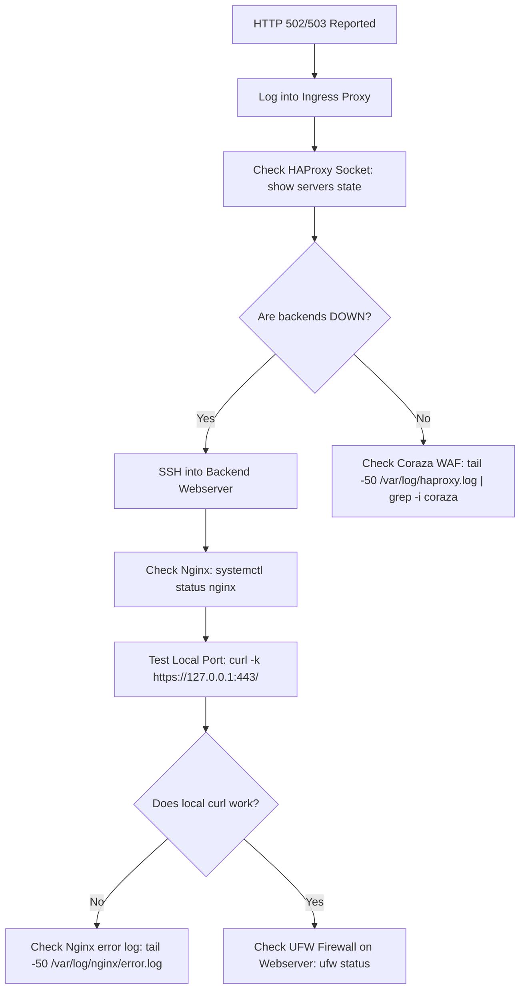

# Administrator Operations & Junior Engineer Troubleshooting Guide

## 1. Executive Overview: The Cluster in Plain English

Welcome to the cluster operations guide. This runbook is specifically written for **systems administrators, operations staff, and junior engineers** who need to inspect, maintain, and troubleshoot this infrastructure in production.

### How Client Traffic Flows (End-to-End)

```mermaid
flowchart TD
    User["Public Internet Client"] -->|HTTPS :443| LB["Cloud NLB or Keepalived VIP (10.0.1.5)"]
    LB -->|TCP Passthrough| Proxy["HAProxy Edge Ingress Fleet (proxies)"]
    
    subgraph Edge Layer [Edge Ingress & Protection]
        Proxy --> WAF["Coraza WAF (OWASP Core Rule Set)"]
        WAF --> RateLimit["In-Memory Rate Limiter (300 req/10s)"]
        RateLimit --> SSLTerm["ACME Public TLS Termination"]
    end

    SSLTerm -->|Zero-Trust Internal TLS :443 (Internal CA)| Web["Nginx Webservers (webservers)"]

    subgraph Backend Services [Data & Broker Tiers]
        Web -->|SQL :5432| DB["PostgreSQL / MySQL (databases)"]
        Web -->|Session/Cache :6379| Redis["Redis In-Memory Cache (redis_servers)"]
        Web -->|AMQP :5672| RMQ["RabbitMQ Message Broker (rabbitmq_servers)"]
    end

    subgraph Telemetry & Governance [Observability & Identity]
        AllNodes["All Fleet Nodes"] -->|Syslog TLS :6514| Syslog["Central Rsyslog Collector (monitoring)"]
        AllNodes -->|Metrics :9100| Prom["Prometheus Server (monitoring)"]
        Prom --> Grafana["Grafana Dashboards :3000"]
        Admin["Administrator"] -->|Zero-Trust Tunnel :3080| TP["Teleport Access Gateway"]
        Admin -->|Kerberos / LDAP :88/389| IPA["FreeIPA Identity Server"]
        Admin -->|Emergency Break-Glass SSH :22| LocalSSH["Local UNIX Admin Accounts"]
    end
```

### What Each Inventory Group Does
* **`[proxies]`**: Front-facing HAProxy load balancers. Terminates public Let's Encrypt SSL, runs Coraza WAF, enforces rate limits, manages the shared VRRP Floating IP (Keepalived), and hosts the replicated Cluster Internal CA.
* **`[webservers]`**: Nginx web applications. Listens on internal port 443 with certificates signed by the internal CA; serves sites or forwards to PHP-FPM/Node.js/Python runtimes.
* **`[databases]`**: Stateful relational database tier running PostgreSQL (primary write master + read replicas with PgBouncer connection pooling) or MySQL.
* **`[redis_servers]`**: High-speed in-memory cache and centralized user session store.
* **`[rabbitmq_servers]`**: Asynchronous AMQP message broker and worker task queue.
* **`[monitoring]`**: Telemetry and observability host running Prometheus, Grafana, Alertmanager, and Central Rsyslog log aggregation.
* **`[teleport_servers]`**: Zero-trust boundary gateway providing browser-based consoles, audit recording, and JIT elevation.
* **`[freeipa_servers]`**: Enterprise identity authority managing Kerberos KDC, LDAP 389 Directory, and centralized SSSD access.

---

## 2. Connecting to the Infrastructure

Administrators have three distinct tiers for logging in:

### Tier 1: Zero-Trust Teleport Gateway (Standard Daily Operations)
```bash
# 1. Log in to the Teleport proxy:
tsh login --proxy=teleport.example.com:3080

# 2. View available nodes:
tsh ls

# 3. Connect to a target node:
tsh ssh ubuntu@web-01

# 4. Request temporary elevated sudo rights (if a junior admin):
tsudo "Fixing Nginx configuration on web-01"
```

### Tier 2: FreeIPA Kerberos / SSSD (Enterprise Identity)
```bash
# 1. Obtain a Kerberos ticket:
kinit admin

# 2. SSH into cluster nodes directly using centralized POSIX credentials:
ssh admin@web-01.internal.lan
```

### Tier 3: Out-of-Band Break-Glass Access (Emergency Only)
If Teleport, FreeIPA, and DNS are completely offline, connect directly via local administrator accounts provisioned by `vars/admin_users.yml`:
```bash
ssh -i ~/.ssh/id_cluster_admin_2026 ubuntu@10.0.1.10
```

---

## 3. Where Things Live: The "Dirty Dozen" Service Matrix

Keep this table handy during incident response:

| Service | Systemd Unit | Config Path | Log File / Command | Runtime Socket / Port |
| :--- | :--- | :--- | :--- | :--- |
| **HAProxy** | `haproxy.service` | `/etc/haproxy/haproxy.cfg` | `/var/log/haproxy.log` | `/run/haproxy/admin.sock` (Ports 80, 443, 8404) |
| **Keepalived** | `keepalived.service` | `/etc/keepalived/keepalived.conf` | `journalctl -u keepalived` | VRRP Multicast / Unicast (Port 112) |
| **ACME Client** | `haproxy-cert-reconcile.service` | `/root/.acme.sh/` | `/var/log/acme-cert-sync.log` | Staggered systemd timers |
| **Internal CA** | `internal-ca-signer.service` | `/etc/ssl/internal/ca/` | `journalctl -u internal-ca-signer` | HTTP Port 8444 (Private VPC only) |
| **Nginx** | `nginx.service` | `/etc/nginx/sites-enabled/` | `/var/log/nginx/error.log` | Port 443 (Internal TLS) |
| **PostgreSQL**| `postgresql.service` | `/etc/postgresql/*/main/postgresql.conf` | `/var/log/postgresql/` | Port 5432 (or PgBouncer 6432) |
| **Redis** | `redis-server.service` | `/etc/redis/redis.conf` | `/var/log/redis/redis-server.log` | Port 6379 (TCP or TLS) |
| **RabbitMQ** | `rabbitmq-server.service` | `/etc/rabbitmq/rabbitmq.conf` | `/var/log/rabbitmq/` | Port 5672 (AMQP), 15672 (UI) |
| **Prometheus**| `prometheus.service` | `/etc/prometheus/prometheus.yml` | `journalctl -u prometheus` | Port 9090 |
| **Grafana** | `grafana-server.service`| `/etc/grafana/grafana.ini` | `/var/log/grafana/grafana.log` | Port 3000 |
| **Rsyslog** | `rsyslog.service` | `/etc/rsyslog.d/` | `/var/log/remote/<host>/` | Port 6514 (TLS) or 5140 (TCP) |
| **Teleport** | `teleport.service` | `/etc/teleport.yaml` | `/var/log/teleport.log` | Ports 3080 (Web), 3023 (SSH) |

---

## 4. Daily Operational Cheatsheet

### 1. Draining a Backend Webserver without Dropping Traffic
Before doing manual maintenance or restarting software on a backend webserver, **drain it from HAProxy** so existing sessions finish cleanly:
```bash
# Log in to any proxy and issue the socket command:
echo "set server be_app_example_com/web-01 state drain" | sudo socat stdio /run/haproxy/admin.sock

# Wait 10-15 seconds for ongoing connections to finish, then take offline:
echo "set server be_app_example_com/web-01 state maint" | sudo socat stdio /run/haproxy/admin.sock

# Once maintenance is complete, reintroduce node into service:
echo "set server be_app_example_com/web-01 state ready" | sudo socat stdio /run/haproxy/admin.sock
```

### 2. Inspecting HAProxy Live Status via Socket
```bash
# List all backend servers and their UP/DOWN status:
echo "show servers state" | sudo socat stdio /run/haproxy/admin.sock

# Check active connection rate limits:
echo "show table fe_http" | sudo socat stdio /run/haproxy/admin.sock
```

### 3. Running Cluster Health & Smoke Tests
From the Ansible controller:
```bash
ansible-playbook -i inventory.ini verify_cluster.yml
```

### 4. Running Controlled Non-Destructive Chaos Drills
Validates that proxy VIP failover, backend crash detection, and broker health checks actually work:
```bash
ansible-playbook -i inventory.ini chaos_drill.yml
```

### 5. Running Zero-Downtime Rolling Upgrades
Applies OS package updates, drains backends serially, reboots if the Linux kernel requires it, and verifies health:
```bash
ansible-playbook -i inventory.ini rolling_maintenance.yml
```

---

## 5. Junior Engineer Emergency Triage Runbooks

### Incident 1: "The website is returning HTTP 503 or 502"



#### Step-by-Step Fix:
1. **Check HAProxy live backend health**:
   ```bash
   echo "show servers state" | sudo socat stdio /run/haproxy/admin.sock
   ```
   If backends show `DOWN`, HAProxy health checks are failing.
2. **Log in to the affected backend webserver**:
   ```bash
   sudo systemctl status nginx
   ```
   If Nginx is stopped, start it: `sudo systemctl start nginx`.
3. **Verify local HTTPS responsiveness**:
   ```bash
   curl -vk https://127.0.0.1:443/ -H "Host: app.example.com"
   ```
   If this returns SSL handshake errors, check the internal certificate:
   ```bash
   sudo /usr/local/bin/renew-internal-cert.sh --force
   ```
4. **Verify firewall allows traffic from proxies**:
   ```bash
   sudo ufw status verbose
   ```
   Ensure port 443 is permitted from your proxy subnet (`10.0.1.0/24`).

---

### Incident 2: "Virtual IP (VIP) is not responding or Keepalived flapping"

1. **Find out which proxy currently holds the VIP**:
   ```bash
   # Run on proxy-01 and proxy-02:
   ip addr show | grep 10.0.1.5
   ```
   *Only ONE proxy should hold the VIP.*
2. **If neither proxy holds the VIP**:
   ```bash
   sudo systemctl status keepalived
   sudo journalctl -u keepalived -n 50 --no-pager
   ```
3. **Common culprits**:
   * Kernel sysctl parameter missing: Ensure `net.ipv4.ip_nonlocal_bind = 1` is set (`sysctl -p /etc/sysctl.d/99-keepalived.conf`).
   * UFW blocking VRRP protocol: Ensure `sudo ufw allow in proto 112` is enabled.
   * HAProxy tracking script failure: Check `/usr/local/bin/check_haproxy.sh`. If HAProxy is stopped, Keepalived intentionally drops priority.

---

### Incident 3: "SSL / TLS Certificate is Expired or Expiring Soon"

#### For Public Let's Encrypt Certificates (on `[proxies]`):
1. Check the ACME renewal log:
   ```bash
   sudo tail -100 /var/log/acme-cert-sync.log
   ```
2. Manually trigger a renewal test on the primary proxy (`proxy-01`):
   ```bash
   sudo /root/.acme.sh/acme.sh --cron --home /root/.acme.sh
   ```
3. If public DNS or HTTP-01 challenge is failing, verify HAProxy routes `.well-known/acme-challenge/` to `backend be_acme` (port 8080).
4. Synchronize new certificates across the proxy fleet:
   ```bash
   sudo /usr/local/bin/sync-haproxy-certs.sh
   ```

#### For Internal TLS Certificates (on `[webservers]`):
1. Force re-issuance from the internal CA:
   ```bash
   sudo /usr/local/bin/renew-internal-cert.sh --force
   ```
2. Check that the proxy CA signer is listening:
   ```bash
   curl -I http://10.0.1.10:8444/health
   ```

---

### Incident 4: "Server Memory Exhaustion or OOM Killer Alert"

1. **Inspect memory state**:
   ```bash
   free -h
   ps aux --sort=-%mem | head -15
   ```
2. **Check if Linux kernel terminated any process**:
   ```bash
   sudo dmesg -T | grep -i -E "oom|killed process"
   ```
3. **Immediate Relief (Zero Downtime)**:
   * **If Redis**: Increase `maxmemory` live:
     ```bash
     redis-cli -a '<vault_password>' config set maxmemory 2gb
     ```
   * **If PHP-FPM / Python workers**: Reduce worker count in `/etc/php/*/fpm/pool.d/www.conf` (`pm.max_children = 20`) and reload: `sudo systemctl reload php*-fpm`.
4. **Long-Term Scaling**:
   Follow the vertical scaling procedure in [docs/resource-sizing-and-scaling.md](resource-sizing-and-scaling.md).

---

### Incident 5: "Server Disk Space Low (< 15%) or Critical (< 5%)"

1. **Identify the bloated directory**:
   ```bash
   df -h /
   sudo du -xh / --max-depth=2 | sort -rh | head -15
   ```
2. **Check the Top 3 Usual Suspects**:
   * **Systemd Journald**:
     ```bash
     sudo journalctl --vacuum-size=500M
     ```
   * **Ghost Files (Deleted but held open by running processes)**:
     ```bash
     sudo lsof +L1
     # If a deleted log file is held open by rsyslog or nginx, reload the daemon:
     sudo systemctl reload nginx
     ```
   * **PostgreSQL WAL Archives**:
     Check `/var/lib/postgresql/*/main/pg_wal`.
3. **Online Disk Expansion (Zero Downtime)**:
   Expand the cloud volume in your cloud provider console, then expand the Linux partition live:
   ```bash
   sudo growpart /dev/nvme0n1 1    # or /dev/sda 1
   sudo resize2fs /dev/nvme0n1p1  # or /dev/sda1
   df -h /
   ```

---

### Incident 6: "Database Replica Lag or Connection Saturation"

1. **Check replication lag on the read replica**:
   ```sql
   SELECT now() - pg_last_xact_replay_timestamp() AS replication_lag;
   ```
2. **Check connection count on primary write master**:
   ```sql
   SELECT count(*), state FROM pg_stat_activity GROUP BY state;
   ```
3. **Kill hung / idle transactions**:
   ```sql
   SELECT pg_terminate_backend(pid) 
   FROM pg_stat_activity 
   WHERE state = 'idle in transaction' 
     AND state_change < now() - INTERVAL '10 minutes';
   ```
4. **Ensure web applications connect to PgBouncer** (port 6432) instead of connecting directly to PostgreSQL (port 5432).

---

## 6. The Golden Rules for Operators & Juniors

1. **Never edit files manually on production servers without documenting**: Ansible maintains state. Changes made by hand might be overwritten on the next playbook run.
2. **Always test syntax before reloading services**:
   * Nginx: `sudo nginx -t`
   * HAProxy: `sudo haproxy -c -f /etc/haproxy/haproxy.cfg`
   * Sudoers: `sudo visudo -c`
3. **Prefer `reload` over `restart`**: Commands like `systemctl reload nginx` and `systemctl reload haproxy` apply changes instantly without terminating existing TCP sessions.
4. **Verify before and after changes**: Run `ansible-playbook -i inventory.ini verify_cluster.yml` before and after major maintenance windows.
