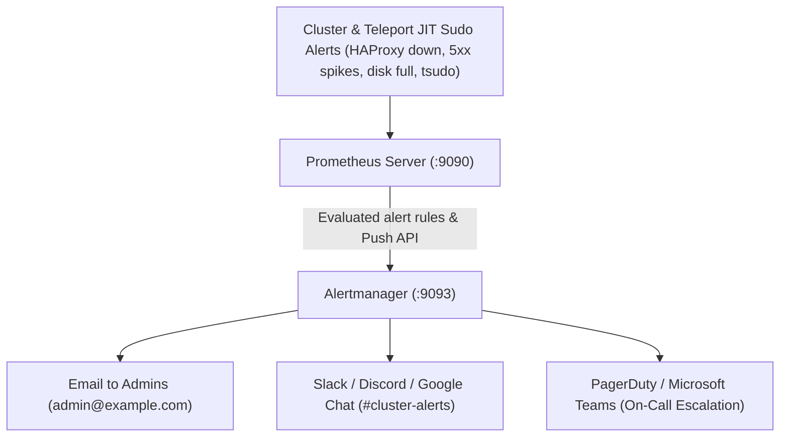

# Alertmanager Notifications & Alert Routing

## Overview

The cluster monitoring stack includes **Prometheus Alertmanager** running on port `9093` of the monitoring host (`roles/prometheus_server`). 

Alertmanager receives alerts evaluated by Prometheus, deduplicates and groups them, silences or inhibits downstream alarms, and dispatches notifications:
- **Default Delivery**: Direct email notifications to cluster administrators defined in `vars/admin_users.yml`.
- **Supported Integrations**: Turnkey configuration examples for **Slack**, **PagerDuty**, **Discord**, and **Microsoft Teams**.

---

## Architecture



---

## 1. Default Email Notifications to Admins

Alertmanager automatically extracts recipient addresses from `vars/admin_users.yml` so all designated administrative users receive alerts:

```yaml
# In roles/prometheus_server/defaults/main.yml
alertmanager_email_enabled: true
alertmanager_email_from: "alerts@example.com"
alertmanager_email_to: "{{ admin_users | map(attribute='email') | select('defined') | list }}"
alertmanager_smtp_smarthost: "smtp.example.com:587"
alertmanager_smtp_auth_username: "apikey"
alertmanager_smtp_auth_password: "{{ vault_alertmanager_smtp_password }}"
alertmanager_smtp_require_tls: true
```

When an alert fires or resolves, administrators receive an email containing the alert title, description, severity, and impacted node instance.

---

## 2. Channel Integrations & Examples

Ready-to-use template files are available in the [`examples/alertmanager/`](../examples/alertmanager/) directory:

| Integration | Example File | Setup Overview |
| :--- | :--- | :--- |
| **Slack** | [`alertmanager-slack.yml`](../examples/alertmanager/alertmanager-slack.yml) | Posts formatted message cards to `#cluster-alerts` using an Incoming Webhook. |
| **PagerDuty** | [`alertmanager-pagerduty.yml`](../examples/alertmanager/alertmanager-pagerduty.yml) | Integrates with PagerDuty Events API v2 via `routing_key` for on-call paging. |
| **Discord** | [`alertmanager-discord.yml`](../examples/alertmanager/alertmanager-discord.yml) | Direct webhook delivery to Discord using Discord's Slack-compatible `/slack` endpoint. |
| **Microsoft Teams** | [`alertmanager-teams.yml`](../examples/alertmanager/alertmanager-teams.yml) | Delivers alerts to MS Teams channels via Power Automate / Workflow HTTP webhook. |
| **Google Chat** | [`alertmanager-google-chat.yml`](../examples/alertmanager/alertmanager-google-chat.yml) | Translates alerts to Google Chat Cards v2 via [google_chat_relay.py](../examples/alertmanager/google_chat_relay.py). See [Guide](google-chat-alerts.md). |
| **Multi-Channel** | [`alertmanager-multi-channel.yml`](../examples/alertmanager/alertmanager-multi-channel.yml) | Unified severity routing: Critical → PagerDuty + Email, Warning → Chat. |

---

## 3. Applying Custom Alertmanager Configurations

To deploy a custom routing configuration to your cluster:

1. Update `alertmanager.yml.j2` or set `prometheus_alertmanager_config_file` in your group variables.
2. Protect API tokens and webhook secrets in `group_vars/all/vault.yml`.
3. Apply the configuration using Ansible tags:
   ```bash
   ansible-playbook -i inventory.ini playbook.yml --tags alertmanager
   ```
4. Verify the running configuration:
   ```bash
   amtool config routes --alertmanager.url=http://127.0.0.1:9093
   ```
