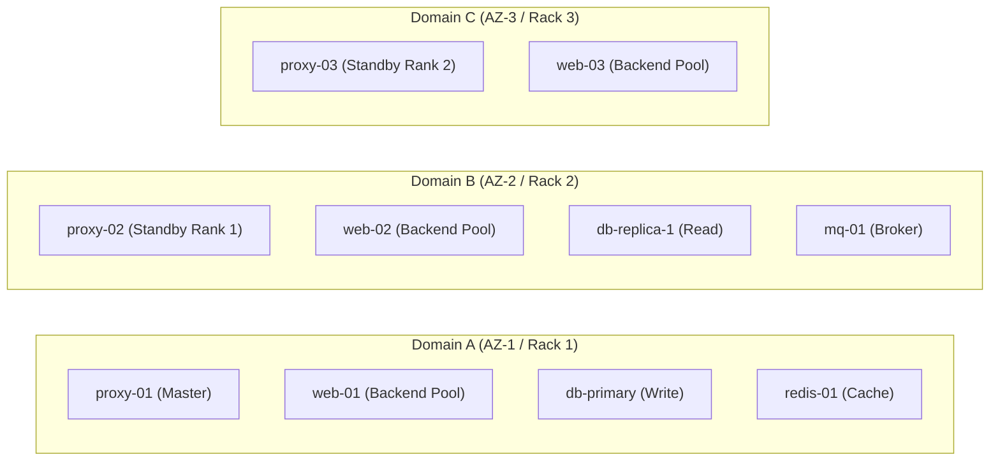

# Anti-Affinity, Fault Domains & High-Availability Resilience

## Overview

A high-availability architecture is only as resilient as its underlying failure domains. If multiple redundant software nodes run on the same physical host, rack, or hypervisor, a single hardware crash, power outage, or hypervisor kernel panic will take down the entire redundant tier simultaneously.

This guide provides a comprehensive audit of **Anti-Affinity enforcement** across the entire cluster architecture—covering Edge Proxies, Pooled Webservers, Databases, and Messaging/Cache tiers across all supported cloud and bare-metal providers.

---

## 1. Anti-Affinity Matrix by Infrastructure Tier



| Infrastructure Tier | Minimum Nodes | Failure Isolation Strategy | Impact if Anti-Affinity is Absent |
| :--- | :--- | :--- | :--- |
| **Frontend Edge Proxies (`proxies`)** | 3 (1 Primary, 2 Standbys) | Anti-affinity across distinct AZs / Fault Domains / Nova Server Groups. | Single hypervisor fault destroys VRRP master AND backups; edge ingress drops. |
| **Clustered Webservers (`webservers`)** | 2–3 (Pooled active-active) | Anti-affinity across distinct AZs / Fault Domains / Nova Server Groups. | Physical host failure drops all backend targets, resulting in HTTP 503. |
| **Database Tier (`databases`)** | 2 (Primary + Streaming Replica) | Cross-zone / cross-hypervisor anti-affinity. Multi-AZ managed storage. | Hardware failure kills both primary and replica; catastrophic downtime and data recovery delay. |
| **Cache & Task Queue (`redis_servers`, `rabbitmq_servers`)** | 1–2 per tier | Separation from primary database host. Cloud-native multi-AZ clustering. | Memory pressure on Redis/RabbitMQ can starve database or webserver processes if co-located. |

---

## 2. Implementation Across Cloud Providers

### A. OpenStack (Nova Anti-Affinity Server Groups)

On OpenStack, anti-affinity is enforced by the Nova compute scheduler via **Server Groups** with the `anti-affinity` policy:

1. **Proxy Anti-Affinity Group (`proxy-anti-affinity`)**:
   Ensures `proxy-01`, `proxy-02`, and `proxy-03` are placed on physically separate compute hypervisors.
2. **Webserver Anti-Affinity Group (`web-anti-affinity`)**:
   Ensures `web-01`, `web-02`, and `web-03` run across distinct hypervisors.
3. **Decoupled Groups**:
   By using separate groups for proxies and webservers, a 3-node physical hypervisor cluster can host:
   - Hypervisor 1: `proxy-01` + `web-01`
   - Hypervisor 2: `proxy-02` + `web-02`
   - Hypervisor 3: `proxy-03` + `web-03`
   If Hypervisor 1 suffers a catastrophic crash:
   - HAProxy traffic fails over to `proxy-02` via Keepalived VRRP.
   - Web traffic fails over to `web-02` and `web-03` via HAProxy health checking.
   **Zero downtime achieved!**

Configuration in [`examples/provisioning/vars_openstack.yml`](../examples/provisioning/vars_openstack.yml):
```yaml
os_server_group_name: "proxy-anti-affinity"
os_server_group_policy: "anti-affinity"
os_web_server_group_name: "web-anti-affinity"
os_web_server_group_policy: "anti-affinity"
```

---

### B. Amazon Web Services (AWS EC2)

1. **Multi-Availability Zone Subnet Distribution**:
   Subnets span distinct physical AWS data center facilities (`us-east-1a`, `us-east-1b`, `us-east-1c`), guaranteeing independent power, cooling, and physical security.
   - `proxy-01` & `web-01` → `us-east-1a` (`cluster-subnet-1a`)
   - `proxy-02` & `web-02` → `us-east-1b` (`cluster-subnet-1b`)
   - `proxy-03` & `web-03` → `us-east-1c` (`cluster-subnet-1c`)
2. **EC2 Spread Placement Groups**:
   For deployments requiring rack-level isolation within or across AZs, instances can be assigned to an EC2 Placement Group with strategy `spread` (`amazon.aws.ec2_placement_group`), guaranteeing that instances run on distinct physical hardware racks with separate power and network switches.
3. **AWS RDS Multi-AZ & Amazon MQ**:
   Cloud-native database and message broker services automatically provision synchronous physical standby instances in a secondary availability zone with automated failover.

---

### C. Google Cloud Platform (GCP)

1. **Multi-Zone VM Distribution**:
   Instances are provisioned across independent Compute Engine zones within the region (`us-central1-a`, `us-central1-b`, `us-central1-c`):
   - `proxy-01` & `web-01` → `us-central1-a`
   - `proxy-02` & `web-02` → `us-central1-b`
   - `proxy-03` & `web-03` → `us-central1-c`
2. **Regional Cloud SQL & Memorystore Standard HA**:
   Managed services configure automatic cross-zone replication with sub-minute automated failover.

---

### D. Microsoft Azure

1. **Availability Zones (`zone: 1`, `zone: 2`, `zone: 3`)**:
   VM instances for proxies and webservers are assigned to distinct Availability Zones, each with isolated power, cooling, and networking.
2. **Proximity Placement Groups & Availability Sets**:
   For regions without 3 Availability Zones, Azure Availability Sets assign VMs across distinct Update Domains and Fault Domains (physical racks).
3. **Azure PostgreSQL Flexible Server Zone-Redundant**:
   Provisions standby servers in a secondary availability zone with automatic health monitoring and failover.

---

### E. Oracle Cloud Infrastructure (OCI)

1. **Multi-Fault Domain Distribution**:
   OCI data centers are partitioned into multiple **Fault Domains** (`FAULT-DOMAIN-1`, `FAULT-DOMAIN-2`, `FAULT-DOMAIN-3`).
   Each Fault Domain has redundant hardware, top-of-rack switches, and power distribution units (PDUs).
   Instances in [`examples/provisioning/vars_oci.yml`](../examples/provisioning/vars_oci.yml) are systematically assigned:
   - `proxy-01`, `web-01` → `FAULT-DOMAIN-1`
   - `proxy-02`, `web-02` → `FAULT-DOMAIN-2`
   - `proxy-03`, `web-03` → `FAULT-DOMAIN-3`

---

### F. Bare Metal & Private On-Premises Racks

For bare-metal environments:
1. **Physical Rack Separation**: Place `proxy-01`, `proxy-02`, and `proxy-03` in physically separate server cabinets with redundant power feeds (A/B UPS feeds).
2. **Top-of-Rack (ToR) Switch Redundancy**: Connect proxy and web nodes to redundant ToR switches with LACP / 802.3ad bonding.
3. **Keepalived VRRP**: Ingress floating IP migrates seamlessly between nodes using gratuitous ARP when a physical host or link drops.
