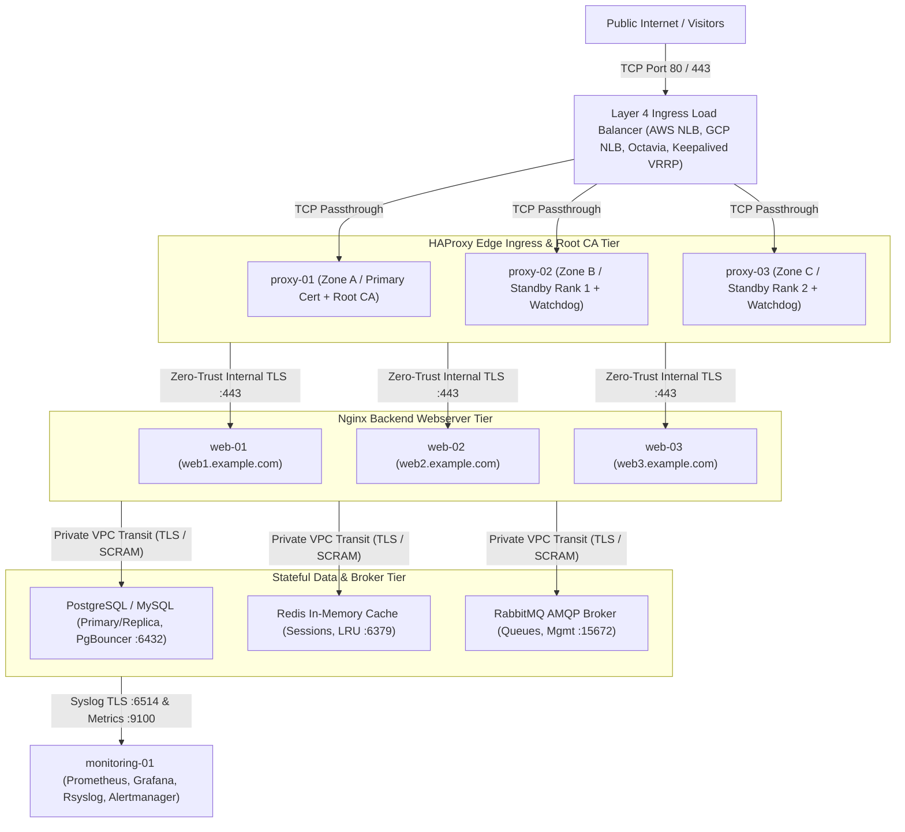

# Cloud & Backend Agnostic High-Availability Architecture

This architecture relies on a **generic Layer 4 (TCP passthrough) Ingress Load Balancer** distributing inbound HTTP/HTTPS traffic to a tier of headless Ubuntu HAProxy frontends.

Because Layer 4 operates at the transport layer without terminating TLS or altering HTTP headers:
- **Client Source IP addresses are preserved transparently** without proprietary headers or proxy protocols.
- **SSL termination, certificates, and virtual routing stay 100% inside your control** within the HAProxy cluster.
- **Zero Cloud Vendor Lock-In**: The same code runs on AWS, GCP, OpenStack, Azure, OCI, or bare metal with zero proprietary agent or cloud CLI dependencies.

---

## Provider Drop-in Mapping

| Provider | Layer 4 Ingress Load Balancer | Fault Domain / Distribution | Private Subnet Example | Inventory Template |
| :--- | :--- | :--- | :--- | :--- |
| **AWS EC2** | **AWS Network Load Balancer (NLB)** (TCP 80/443 with cross-zone load balancing) | Multiple Availability Zones (`us-east-1a`, `1b`, `1c`) | `172.31.0.0/16` | [inventory.aws.ini](../examples/inventories/inventory.aws.ini) |
| **Google Cloud (GCP)** | **Regional External TCP/UDP Passthrough Network Load Balancer** | Multiple Compute Engine Zones (`us-central1-a`, `1-b`, `1-c`) | `10.128.0.0/20` | [inventory.gcp.ini](../examples/inventories/inventory.gcp.ini) |
| **Microsoft Azure** | **Azure Standard Load Balancer** (TCP 80/443 load balancing rules) | Multiple Availability Zones (`1`, `2`, `3`) | `10.240.0.0/16` | [inventory.azure.ini](../examples/inventories/inventory.azure.ini) |
| **Oracle Cloud (OCI)** | **OCI Network Load Balancer (NLB)** (TCP listener) | Multiple Fault Domains (FD-1, FD-2, FD-3) | `10.0.0.0/16` | [inventory.oci.ini](../examples/inventories/inventory.oci.ini) |
| **OpenStack** | **Octavia Load Balancer** (TCP Amphora listener) or **Keepalived VIP** | Nova Server Group (`anti-affinity`) across hypervisors | `192.168.100.0/24` | [inventory.openstack.ini](../examples/inventories/inventory.openstack.ini) |
| **Bare Metal / On-Prem** | **Keepalived VRRP Floating IP** or **BGP Anycast (ECMP)** | Separate physical racks / PDUs | `10.x`, `172.16.x`, `192.168.x` | [inventory.ini](../inventory.ini) |

---

## Universal Network & Firewall Compatibility

- **RFC 1918 Private Subnets**: Out of the box, UFW and Nginx `real_ip` trust all standard private subnets (`10.0.0.0/8`, `172.16.0.0/12`, and `192.168.0.0/16`), allowing seamless operation regardless of private VPC CIDR blocks.
- **Zero Cloud Agent Dependencies**: The fleet provisions standard headless Ubuntu (20.04, 22.04, 24.04 LTS) images using standard SSH and sudo. No proprietary CLI tools, cloud agents, or IAM roles are required.

---

## Flexible Backend Routing Topologies (1:1 Dedicated vs. N:1 Clustered Pools)

In this architecture, HAProxy serves as an intelligent reverse proxy that routes traffic based on incoming HTTP `Host` headers directly to designated backend webservers. The cluster supports three routing topologies:

- **Scenario 1: Dedicated 1:1 Backends**: Each webserver specifies a unique `external_fqdn` in the inventory, hosting an isolated tenant application.
- **Scenario 2: Pooled N:1 Clustered Backends**: Multiple webservers share the same `external_fqdn` (or `backend_pool`), forming an active-active load-balanced pool with round-robin distribution and zero-downtime rolling maintenance.
- **Scenario 3: Hybrid Architecture**: Clustered core services and isolated tenant webservers coexisting in the same deployment.

Non-matching or unmapped hostnames/IPs are caught by a strict generic 404 fallback on the backend, preventing information disclosure or unintended virtual host leakage.

For an in-depth comparison, architectural diagrams, state management guidance, and configuration examples, see the [Backend Webserver Topologies Guide](backend-topologies.md).

---

## Modular Database Tier (PostgreSQL, MySQL & Cloud-Native Services)

The cluster provides an optional, modular database tier supporting both automated self-hosted instances and cloud-native managed database services:

- **Engines**: **PostgreSQL** (preferred default with SCRAM-SHA-256 and JSONB) and **MySQL** (8.0).
- **Self-Hosted (`roles/database`)**: Automated provisioning of hardened database nodes on cluster VMs with private subnet firewalling.
- **Cloud-Native Managed Services**: Drop-in examples and integration with AWS RDS PostgreSQL, GCP Cloud SQL for PostgreSQL, Azure Database for PostgreSQL Flexible Server, and OCI PostgreSQL.

For full architectural designs across all three topologies, provisioning guides, and disaster recovery procedures, see the [Database Architecture Guide](database-architecture.md).

---

## In-Memory Caching & Asynchronous Queuing (Redis & RabbitMQ)

The architecture includes modular tiers for state decoupling and worker pipelines:
- **Redis (`roles/redis`)**: In-memory cache and centralized session store essential for stateless pooled webservers (Scenario 2). Includes LRU eviction, dual RDB/AOF persistence, and cloud-native options (AWS ElastiCache, GCP Memorystore, Azure Cache for Redis).
- **RabbitMQ (`roles/rabbitmq`)**: AMQP 0-9-1 message broker and task queue for background workers. Includes Management Web UI routed through HAProxy with TLS (`mq.<domain>`) and Prometheus telemetry metrics on port 15692. Cloud-native options include Amazon MQ for RabbitMQ.

For detailed configuration, inventory patterns, and operational procedures, see the [Cache and Queue Architecture Guide](cache-and-queue-architecture.md).

---

## Centralized Identity & Access Management (Teleport vs. FreeIPA vs. Both)

The cluster provides modular choices for identity and access management configured via `identity_provider`:
- **Teleport** (`identity_provider: "teleport"`): Zero-Trust modern SSH, short-lived certificates, and browser-based access console. See [teleport-access.md](teleport-access.md).
- **FreeIPA** (`identity_provider: "freeipa"`): Enterprise Linux identity management featuring Kerberos KDC, LDAP 389 Directory Server, SSSD integration, centralized sudo rules, and centralized SSH key lookup. See [freeipa-identity.md](freeipa-identity.md).
- **Dual Deployment** (`identity_provider: "both"`): Coexistence of FreeIPA for Linux POSIX accounts/SSSD and Teleport for edge boundary SSH gateway with PAM delegation.
- **Break-Glass Basic Auth**: Native HTTP Basic Auth for administrative web interfaces (HAProxy stats UI, RabbitMQ management UI, Grafana) and local UNIX accounts provisioned on every node via `vars/admin_users.yml` for out-of-band console access.

---

## Anti-Affinity & Physical Failure Domain Isolation

High availability requires strict separation of redundant instances across failure domains:
- **Proxies & Clustered Webservers**: Distributed across distinct Availability Zones (AWS `us-east-1a/b/c`, GCP `us-central1-a/b/c`, Azure `zone: 1/2/3`), OCI Fault Domains (`FD-1/2/3`), or OpenStack Nova anti-affinity server groups (`proxy-anti-affinity` and `web-anti-affinity`).
- **Database & Cache**: Primary write masters and streaming read replicas are physically separated across zones to eliminate correlated hardware failure.

For the comprehensive cross-provider anti-affinity matrix, see [anti-affinity-and-resilience.md](anti-affinity-and-resilience.md).

---

## Resource Sizing & Zero-Downtime Vertical Scaling

Cluster nodes include automated pre-flight memory validation (`enforce_min_memory_check: true`), service-level memory limiters (Redis LRU, RabbitMQ memory alarms, PostgreSQL shared buffers), and step-by-step zero-downtime rolling vertical migration procedures. See [resource-sizing-and-scaling.md](resource-sizing-and-scaling.md).

---

## Operations, Administrator Cheatsheet & Junior Troubleshooting

For day-to-day operations, connecting to nodes, service socket locations, drain commands, and step-by-step emergency runbooks (502/503 errors, certificate expirations, VIP drops, OOM/memory pressure, disk space, and database replica lag), see the [Administrator Operations & Junior Troubleshooting Guide](administrator-and-troubleshooting-guide.md).
