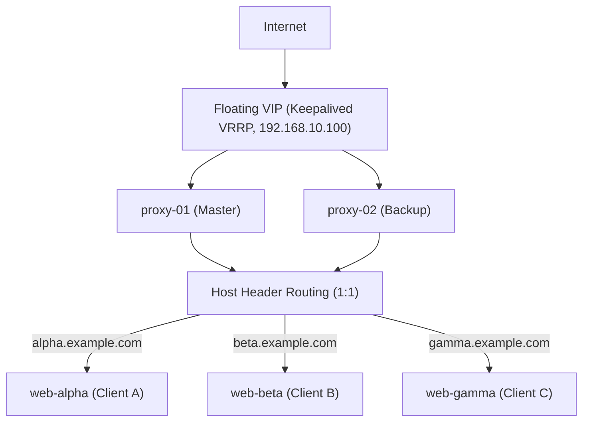
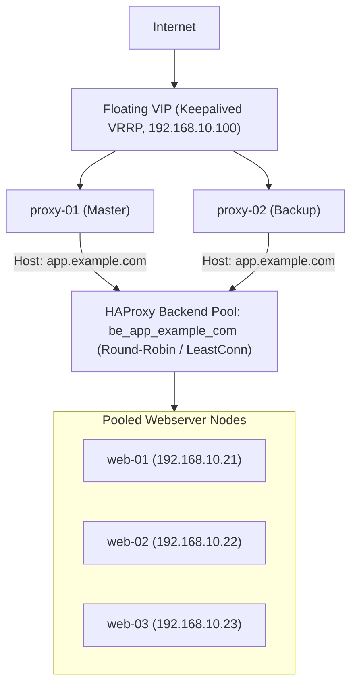
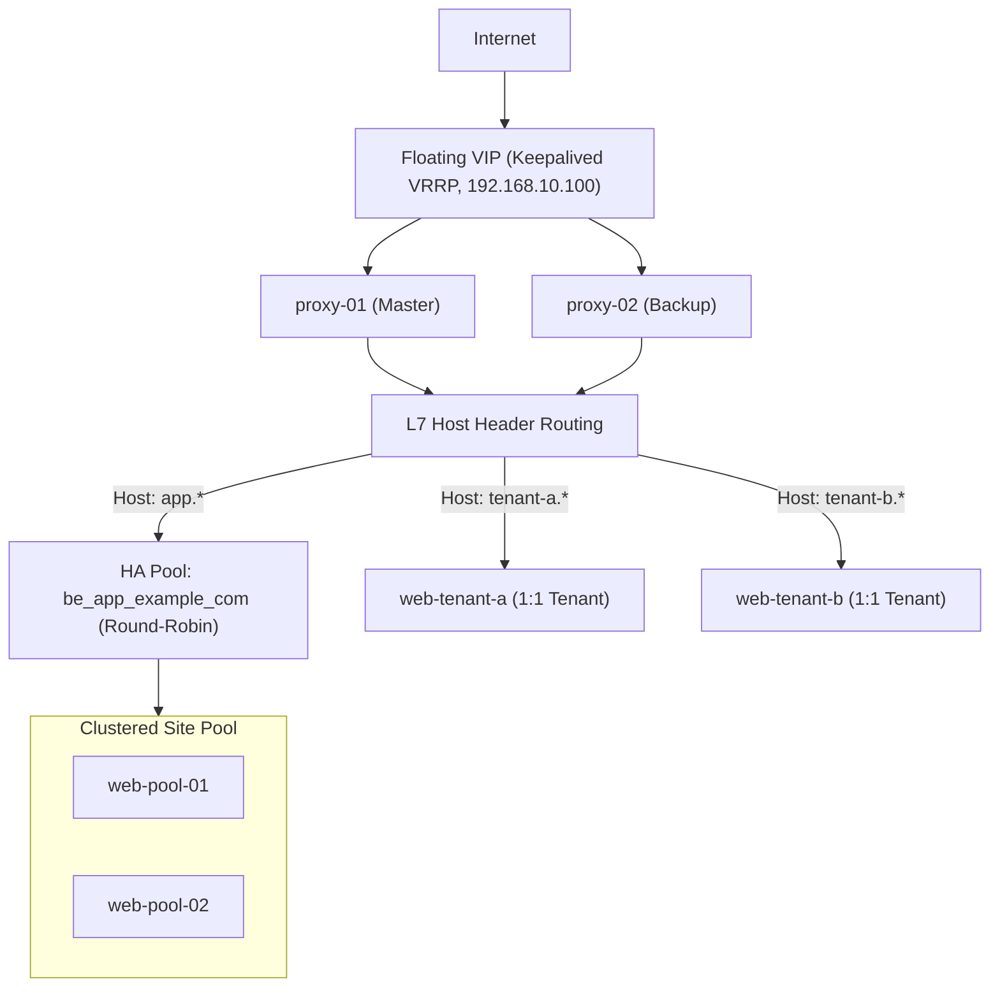

# Backend Webserver Topologies: Dedicated 1:1 vs. Pooled N:1 Clusters

## Overview

The cluster automation framework supports two primary backend deployment topologies, as well as a flexible hybrid pattern that combines both:

1. **Scenario 1: Dedicated 1:1 Webserver Backends** (Unique Clients / Multi-Tenant Isolation)
2. **Scenario 2: Pooled N:1 Load-Balanced Webservers** (High-Availability Clustered Site)
3. **Scenario 3: Hybrid Architecture** (Pooled Core Application + Dedicated Tenant Backends)

This guide details the architectural differences, user experience variations, state management requirements, zero-downtime maintenance behaviors, and inventory configurations for each scenario.

---

## Architecture Comparison Matrix

| Dimension | Scenario 1: Dedicated 1:1 Backends | Scenario 2: Pooled N:1 Clustered Backends |
| :--- | :--- | :--- |
| **Primary Use Case** | Multi-tenant SaaS, client portals, agency hosting, isolated departmental apps | High-traffic web apps, e-commerce, APIs, mission-critical services |
| **Traffic Routing** | 1:1 mapping: each `external_fqdn` maps to a single dedicated webserver | N:1 mapping: a single `external_fqdn` load-balances across multiple webservers |
| **High Availability** | Active-Passive at Proxy/VIP; Single point at web tier (per client) | Active-Active redundancy across all webservers; N-1 fault tolerance |
| **State Management** | **Local / Stateful**: Local file uploads, SQLite, local disk sessions | **Stateless**: Centralized Redis for sessions, S3/NFS for uploads, centralized DB |
| **Rolling Maintenance** | Node reboots cause temporary HTTP 503 for that tenant | **Zero Downtime**: Active nodes drain serially; surviving pool nodes serve 100% of traffic |
| **Failover Experience** | Manual recovery, VM restart, or restore playbook | **Instant & Transparent**: HAProxy drops failed nodes in 3s; users notice zero impact |
| **Load Balancing** | Direct passthrough to dedicated server | Round-robin, least connections, or source hash with optional cookie stickiness |
| **Internal TLS (P-384)** | Dedicated ECDSA P-384 cert per tenant domain | Shared SAN cert with node IP/hostname + pool FQDN |

---

## Scenario 1: Dedicated 1:1 Webserver Backends

### Concept & Request Flow

In Scenario 1, each webserver in the `[webservers]` inventory group is dedicated to a distinct client or application tenant with its own unique `external_fqdn`.



### Inventory Configuration

In `inventory.ini`, each host has a distinct `external_fqdn`:

```ini
[webservers]
web-alpha ansible_host=192.168.10.21 external_fqdn=alpha.example.com internal_ip=192.168.10.21
web-beta  ansible_host=192.168.10.22 external_fqdn=beta.example.com  internal_ip=192.168.10.22
web-gamma ansible_host=192.168.10.23 external_fqdn=gamma.example.com internal_ip=192.168.10.23
```

### Generated HAProxy Configuration

HAProxy generates independent front-end ACLs and 1:1 backends:

```haproxy
frontend fe_https
    acl is_alpha_example_com hdr(host) -i alpha.example.com
    use_backend be_alpha_example_com if is_alpha_example_com

    acl is_beta_example_com hdr(host) -i beta.example.com
    use_backend be_beta_example_com if is_beta_example_com

backend be_alpha_example_com
    mode http
    balance roundrobin
    option forwardfor
    http-request set-header Host alpha.example.com
    server web-alpha 192.168.10.21:443 ssl verify required ca-file /etc/haproxy/certs/internal-ca.crt check

backend be_beta_example_com
    mode http
    balance roundrobin
    option forwardfor
    http-request set-header Host beta.example.com
    server web-beta 192.168.10.22:443 ssl verify required ca-file /etc/haproxy/certs/internal-ca.crt check
```

### Operational Experience for Scenario 1

- **Tenant Isolation**: High security isolation. One tenant cannot consume memory, CPU, or disk of another tenant.
- **Stateful Simplicity**: Ideal for monolithic applications (e.g., WordPress, Drupal, custom Laravel/Django) where sessions and media uploads reside directly on the local disk.
- **Rolling Maintenance Impact**: When `rolling_maintenance.yml` reboots `web-alpha`, HAProxy receives a drain command and marks the server down during reboot. Visitors to `alpha.example.com` receive an HTTP 503 error until Nginx starts back up (typically 10-30 seconds). Maintenance windows should be communicated to clients in advance.

---

## Scenario 2: Pooled N:1 Load-Balanced Webservers

### Concept & Request Flow

In Scenario 2, multiple webservers in the `[webservers]` inventory group share the same `external_fqdn` (e.g., `app.example.com`) or explicit `backend_pool`. HAProxy groups them into a unified backend pool and balances requests across all healthy members.



### Inventory Configuration

Webservers define identical `external_fqdn` values (and optionally `backend_pool` or `backend_balance`):

```ini
[webservers]
web-01 ansible_host=192.168.10.21 external_fqdn=app.example.com internal_ip=192.168.10.21
web-02 ansible_host=192.168.10.22 external_fqdn=app.example.com internal_ip=192.168.10.22
web-03 ansible_host=192.168.10.23 external_fqdn=app.example.com internal_ip=192.168.10.23

[all:vars]
haproxy_balance_algorithm=roundrobin
haproxy_enable_cookie_persistence=false
```

### Generated HAProxy Configuration

HAProxy creates a single frontend ACL and pools all servers in one backend:

```haproxy
frontend fe_https
    # Route for backend pool: app.example.com
    acl is_app_example_com hdr(host) -i app.example.com
    use_backend be_app_example_com if is_app_example_com

backend be_app_example_com
    mode http
    balance roundrobin
    option forwardfor
    http-request set-header Host app.example.com
    option httpchk GET / HTTP/1.1\r\nHost:\ app.example.com
    http-check expect rstatus (2..|3..)
    server web-01 192.168.10.21:443 ssl verify required ca-file /etc/haproxy/certs/internal-ca.crt check inter 3s fall 3 rise 2
    server web-02 192.168.10.22:443 ssl verify required ca-file /etc/haproxy/certs/internal-ca.crt check inter 3s fall 3 rise 2
    server web-03 192.168.10.23:443 ssl verify required ca-file /etc/haproxy/certs/internal-ca.crt check inter 3s fall 3 rise 2
```

### Application Prerequisites for Scenario 2 (Stateless Design)

Because requests from a single client can land on any webserver in the pool, applications **must be designed to be stateless**:

1. **User Sessions**:
   - Store sessions in a shared Redis or Memcached cluster, or use JWT client-side tokens.
   - *Fallback*: If legacy session files cannot be migrated, enable cookie persistence:
     ```ini
     [webservers:vars]
     backend_cookie_persistence=true
     ```
     This instructs HAProxy to insert a `SERVERID` cookie that pins users to the same backend node.
2. **File & Media Uploads**:
   - Do **not** store uploaded files on the local filesystem.
   - Use an S3-compatible object storage (AWS S3, MinIO, Ceph) or an NFS/GlusterFS mount mounted at the same path across all nodes.
3. **Database**:
   - All backend webservers connect to a central database cluster (PostgreSQL with Patroni, MySQL Galera, or managed cloud DB).

### Zero-Downtime Rolling Maintenance in Scenario 2

`rolling_maintenance.yml` provides **true zero-downtime upgrades** in Scenario 2:

1. `web-01` is drained:
   ```bash
   socat stdio /run/haproxy/admin.sock <<< "set server be_app_example_com/web-01 state drain"
   ```
2. Existing TCP connections finish gracefully; new connections route to `web-02` and `web-03`.
3. Maintenance updates packages, applies kernel patches, and reboots `web-01`.
4. Ansible validates local Nginx health:
   ```bash
   curl -k https://127.0.0.1:443/ -H "Host: app.example.com"
   ```
5. `web-01` is restored to `state ready`:
   ```bash
   socat stdio /run/haproxy/admin.sock <<< "set server be_app_example_com/web-01 state ready"
   ```
6. The playbook moves sequentially to `web-02`, then `web-03`. **End users experience zero dropped connections and 100% continuous uptime!**

---

## Scenario 3: Hybrid Architecture (Pooled Core + Dedicated Tenants)

### Concept & Request Flow

In many production deployments, core business services require high-availability pooling, while individual tenants or administrative tools require isolated 1:1 instances.



### Inventory Configuration

Simply define identical FQDNs for the pooled servers, and distinct FQDNs for the dedicated tenants:

```ini
[webservers]
# Clustered HA Pool for Core Web App
web-pool-01  ansible_host=192.168.10.21 external_fqdn=app.example.com internal_ip=192.168.10.21
web-pool-02  ansible_host=192.168.10.22 external_fqdn=app.example.com internal_ip=192.168.10.22

# Dedicated 1:1 Tenant Backends
web-tenant-a ansible_host=192.168.10.23 external_fqdn=tenant-a.example.com internal_ip=192.168.10.23
web-tenant-b ansible_host=192.168.10.24 external_fqdn=tenant-b.example.com internal_ip=192.168.10.24
```

HAProxy handles this cleanly without any manual backend definitions or template overrides.

---

## Zero-Trust Internal TLS (ECDSA P-384) Across Topologies

Both topologies fully support the automated Zero-Trust Internal Certificate Authority:

- **Root CA**: Stored securely on the primary proxy (`proxy-01`), replicated to standby proxies, with automated 2-year ECDSA P-384 root renewal.
- **Leaf Certificates**: Automatically requested by each backend webserver via systemd timer and the internal CA signer HTTP service (`port 8444`).
- **SAN Validation**:
  - In Scenario 1: Leaf cert has `CN = alpha.example.com`, `DNS: web-alpha`, `IP: 192.168.10.21`.
  - In Scenario 2: Each leaf cert has `CN = app.example.com`, `DNS: <hostname>`, `IP: <node_ip>`.
- **Proxy Verification**: HAProxy connects to backend nodes over port 443 with `ssl verify required ca-file /etc/haproxy/certs/internal-ca.crt`, ensuring strict mutual trust across all private network traffic.

---

## Optional Database Tier (PostgreSQL & MySQL)

All three topologies support an optional database tier, deployable as either self-hosted hardened instances (`roles/database`) or cloud-native managed database services:

- **Scenario 1**: Supports multi-tenant shared database nodes with isolated databases and credentials (`alpha_db`, `beta_db`, `gamma_db`), or dedicated database instances.
- **Scenario 2**: Backed by a centralized high-availability database cluster (PostgreSQL preferred) or cloud-native services (AWS RDS, GCP Cloud SQL, Azure Flexible Server) shared across all pooled webservers.
- **Scenario 3**: Accommodates both central core application databases and distinct tenant databases simultaneously.

For full architectural designs, provisioning playbooks, and disaster recovery procedures, see the [Database Architecture Guide](database-architecture.md).

---

## Ready-to-Use Topology Examples

Pre-configured, syntax-validated inventories and detailed readmes are available in the repository:

- [Scenario 1: Dedicated 1:1 Unique Clients](../examples/topologies/scenario-1-unique-clients/README.md)
- [Scenario 2: Pooled N:1 Load-Balanced Webservers](../examples/topologies/scenario-2-pooled-webservers/README.md)
- [Scenario 3: Hybrid Architecture](../examples/topologies/scenario-3-hybrid/README.md)
