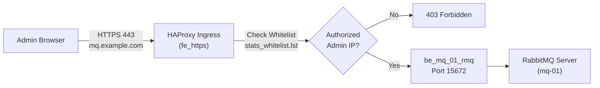

# In-Memory Cache & Message Broker Architecture: Redis, RabbitMQ & Cloud-Native Services

## Overview

Modern web applications operating across load-balanced tiers require decoupled state management and asynchronous processing. The cluster automation framework provides modular, optional **Redis** and **RabbitMQ** layers supporting both self-hosted automated deployment and cloud-native managed integrations:

- **Redis**: High-performance in-memory data store for **shared session storage**, transient query/response caching, and pub/sub.
- **RabbitMQ**: Robust AMQP 0-9-1 **message broker and task queue** for background job dispatching, asynchronous workflows, and distributed worker orchestration.
- **Integration**: Native integration with the cluster's ingress layer (HAProxy routing for RabbitMQ Management Web UI), telemetry tier (Prometheus metrics scraping), operational maintenance (zero-downtime rolling upgrades), and disaster recovery (automated snapshots and rclone offsite replication).

---

## Architecture Matrix by Scenario

| Dimension | Scenario 1: Dedicated 1:1 Tenants | Scenario 2: Pooled N:1 Clustered Site | Scenario 3: Hybrid Architecture |
| :--- | :--- | :--- | :--- |
| **Primary Redis Use Case** | Optional tenant query cache; per-tenant logical database (`db 0`, `db 1`) | **Mandatory Shared Session Store** & HTTP response cache | Shared session store for core pool + tenant isolated caching |
| **Primary RabbitMQ Use Case** | Per-tenant background task queues (via virtual hosts `/alpha`, `/beta`) | **Asynchronous Job Processing** (email queues, PDF generation, heavy computations) | Core queue for clustered app + tenant task queues |
| **Web Tier State Model** | Stateful or stateless (local disk sessions allowed) | **Strictly Stateless**: Sessions offloaded to Redis; state offloaded to DB/S3 | Core web pool is stateless; tenant nodes may be stateful or stateless |
| **Ingress Management UI** | HAProxy routes `mq.<domain>` protected by admin ACL | HAProxy routes `mq.<domain>` protected by admin ACL | HAProxy routes `mq.<domain>` protected by admin ACL |
| **Cloud-Native Equivalent** | AWS ElastiCache / Amazon MQ / GCP Memorystore / Azure Cache | AWS ElastiCache / Amazon MQ / GCP Memorystore / Azure Cache | AWS ElastiCache / Amazon MQ / GCP Memorystore / Azure Cache |

---

## Redis In-Memory Cache & Session Store (`roles/redis`)

### Core Capabilities & Operational Design

In **Scenario 2 (Pooled Webservers)**, multiple backend nodes (`web-01`, `web-02`, `web-03`) serve identical requests behind HAProxy. If user session state were stored locally on webserver filesystems, user logins would break as requests round-robin between servers. Redis provides the centralized in-memory session tier.

- **Listening Port**: `6379` (TCP).
- **Authentication**: Password authentication enforced via `requirepass {{ redis_password }}`.
- **Network Security**: UFW firewall restricts access strictly to trusted private subnets (`10.0.0.0/8`, `172.16.0.0/12`, `192.168.0.0/16`). `protected-mode yes` prevents unauthorized bind escalation.
- **Eviction Policy**: Configured with `maxmemory-policy: allkeys-lru` to evict the least recently used keys when memory exceeds `redis_maxmemory` (default `512mb`), preventing out-of-memory kernel panics.
- **Dual Persistence**:
  - **RDB (Snapshotting)**: Point-in-time binary snapshots saved to `/var/lib/redis/dump.rdb` at scheduled intervals (`900 1`, `300 10`, `60 10000`).
  - **AOF (Append-Only File)**: Transactional durability writing every change to `/var/lib/redis/appendonly.aof` with `appendfsync everysec`.

### Inventory Definition

```ini
[redis_servers]
redis-01 ansible_host=192.168.10.61 internal_ip=192.168.10.61

[redis_servers:vars]
redis_port=6379
redis_maxmemory="1gb"
redis_maxmemory_policy="allkeys-lru"
```

### Key Configuration Variables

| Variable | Default Value | Description |
| :--- | :--- | :--- |
| `enable_redis` | `true` | Master switch to enable or disable the Redis role. |
| `redis_port` | `6379` | TCP port Redis listens on. |
| `redis_bind_address` | `"0.0.0.0"` | Network address to bind (protected by UFW). |
| `redis_password` | Vault-backed secret | Authentication passphrase required for all client connections. |
| `redis_maxmemory` | `"512mb"` | Maximum RAM allocated to Redis before eviction starts. |
| `redis_maxmemory_policy`| `"allkeys-lru"` | Key eviction strategy (`allkeys-lru`, `volatile-lru`, `noeviction`). |
| `redis_appendonly` | `"yes"` | Enables AOF write-ahead logging for durability. |
| `redis_appendfsync` | `"everysec"` | Fsync frequency for AOF (balances durability and disk I/O). |
| `redis_trusted_subnets` | RFC 1918 subnets | List of CIDRs permitted to connect to port 6379 in UFW. |

---

## RabbitMQ Message Broker & Task Queue (`roles/rabbitmq`)

### Core Capabilities & Operational Design

RabbitMQ provides enterprise asynchronous message queuing implementing the AMQP 0-9-1 standard:

- **Decoupled Architecture**: Webservers quickly enqueue long-running jobs (transcoding, notifications, reports) into RabbitMQ and return immediate HTTP 200/202 responses to end users. Background worker processes consume queues asynchronously.
- **Virtual Host Isolation**: Virtual hosts (`rabbitmq_vhost`) provide multi-tenant isolation within a single broker instance, allowing Scenario 1 or Scenario 3 tenants to maintain independent queues and exchange bindings.
- **Management Web UI**: The `rabbitmq_management` plugin operates on port `15672`. HAProxy exposes this UI under `mq.<domain>` with TLS termination, protected by admin IP whitelisting.
- **Prometheus Telemetry**: The `rabbitmq_prometheus` plugin exposes metrics on port `15692/metrics`. The monitoring tier automatically scrapes queue depths, message rates, and memory alarms.
- **Erlang Clustering Ready**: Deploys a consistent cryptographic cluster cookie (`.erlang.cookie` with mode `0400`) enabling multi-node broker clustering.

### Inventory Definition

```ini
[rabbitmq_servers]
mq-01 ansible_host=192.168.10.71 internal_ip=192.168.10.71 rabbitmq_mgmt_fqdn=mq.example.com

[rabbitmq_servers:vars]
rabbitmq_vhost="/app"
rabbitmq_user="app_user"
rabbitmq_admin_user="admin"
```

### Key Configuration Variables

| Variable | Default Value | Description |
| :--- | :--- | :--- |
| `enable_rabbitmq` | `true` | Master switch to enable or disable the RabbitMQ role. |
| `rabbitmq_amqp_port` | `5672` | Standard AMQP client protocol port. |
| `rabbitmq_mgmt_port` | `15672` | Management Web UI and REST API HTTP port. |
| `rabbitmq_prometheus_port`| `15692` | Prometheus telemetry metrics port. |
| `rabbitmq_erlang_cookie`| Vault-backed secret | Cluster authentication cookie for Erlang distribution. |
| `rabbitmq_vhost` | `"/app"` | Default application virtual host. |
| `rabbitmq_user` | `"app_user"` | Application worker credentials for AMQP. |
| `rabbitmq_admin_user` | `"admin"` | Web Management UI administrator username. |
| `rabbitmq_plugins` | `["rabbitmq_management", "rabbitmq_prometheus"]` | RabbitMQ plugins enabled during setup. |
| `rabbitmq_trusted_subnets`| RFC 1918 subnets | Subnets permitted to access AMQP port 5672. |
| `rabbitmq_admin_cidrs` | RFC 1918 subnets | Subnets permitted to access Management UI port 15672. |

---

## Edge Ingress & HAProxy Routing for RabbitMQ Management

HAProxy acts as the secure TLS gateway for the RabbitMQ Management Web UI:



HAProxy dynamically maps the hostname specified in `rabbitmq_mgmt_fqdn` (e.g. `mq.example.com`), verifies client IP against `/etc/haproxy/stats_whitelist.lst`, and forwards requests to the internal management port:

```haproxy
# HAProxy Ingress Rule
acl is_mq_01_rmq hdr(host) -i mq.example.com
acl is_allowed_admin_rmq src -f /etc/haproxy/stats_whitelist.lst
http-request deny deny_status 403 if is_mq_01_rmq !is_allowed_admin_rmq
use_backend be_mq_01_rmq if is_mq_01_rmq

backend be_mq_01_rmq
    mode http
    balance roundrobin
    option forwardfor
    http-request set-header X-Forwarded-Proto https
    server mq-01 192.168.10.71:15672 check inter 5s fall 3 rise 2
```

---

## Cloud-Native Managed Cache & Message Broker Services

For production architectures leveraging hyperscaler infrastructure, the repository provides turnkey Ansible playbooks to provision managed caching and messaging services:

### 1. Amazon Web Services (AWS)
- **AWS ElastiCache for Redis**:
  - Playbook: `examples/provisioning/provision_aws_elasticache_redis.yml`
  - Provisions Multi-AZ Redis replication group with automatic failover, in-transit encryption, and VPC subnet grouping.
- **Amazon MQ for RabbitMQ**:
  - Playbook: `examples/provisioning/provision_aws_amazon_mq.yml`
  - Provisions managed RabbitMQ broker with VPC private endpoints and pre-configured application credentials.

### 2. Google Cloud Platform (GCP)
- **Google Cloud Memorystore for Redis**:
  - Playbook: `examples/provisioning/provision_gcp_memorystore_redis.yml`
  - Provisions `STANDARD_HA` cross-zone Redis instance with automated failover and direct VPC peering.

### 3. Microsoft Azure
- **Azure Cache for Redis**:
  - Playbook: `examples/provisioning/provision_azure_cache_redis.yml`
  - Provisions managed Azure Redis Standard/Premium tier with minimum TLS 1.2 enforcement on port 6380.

---

## Operational Lifecycle & Playbooks

### 1. Verification & Smoke Testing (`verify_cluster.yml`)
The cluster verification playbook validates responsiveness of both tiers:
- **Redis**: Asserts `redis-server` systemd status and executes `redis-cli ping` expecting `PONG`.
- **RabbitMQ**: Asserts `rabbitmq-server` service state, executes `rabbitmq-diagnostics check_running`, and queries the `/api/health/checks/alarms` management endpoint.

```bash
ansible-playbook -i inventory.ini verify_cluster.yml
```

### 2. Zero-Downtime Rolling Upgrades (`rolling_maintenance.yml`)
Maintains the cache and broker nodes with `serial: 1`:
- Sequentially upgrades OS packages, kernel patches, and security fixes.
- Reboots nodes only when `/var/run/reboot-required` exists.
- Confirms Redis PING and RabbitMQ diagnostics pass before moving to the next node.

```bash
ansible-playbook -i inventory.ini rolling_maintenance.yml
```

### 3. Disaster Recovery & Backups (`backup_cluster.yml` / `restore_cluster.yml`)
- **Backup**:
  - Triggers Redis `bgsave` and archives `/var/lib/redis/dump.rdb` and `redis.conf`.
  - Executes `rabbitmqctl export_definitions` to capture all queues, exchanges, bindings, and users into JSON.
  - Compresses archives and synchronizes offsite via configured `rclone` backends (S3, R2, B2, GCS, Azure Blob).
- **Restore**:
  - Pulls snapshot from rclone remote or local storage.
  - Restores `dump.rdb` with correct permissions and restarts Redis.
  - Imports schema definitions into RabbitMQ via `rabbitmqctl import_definitions`.

```bash
# Backup execution
ansible-playbook -i inventory.ini backup_cluster.yml

# Restore execution
ansible-playbook -i inventory.ini restore_cluster.yml -e "restore_snapshot=latest"
```
