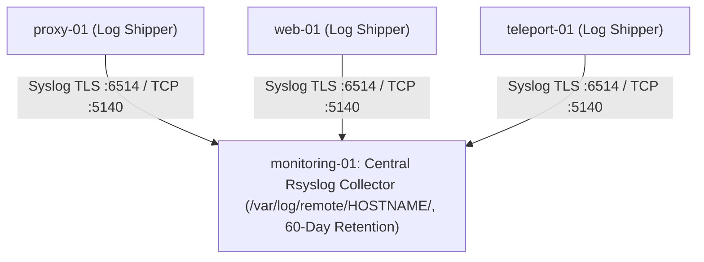

# Centralized Cluster Logging Guide

This suite includes a dedicated centralized log aggregation role (`roles/central_logging`) that streams systemd journal entries, HAProxy traffic and script logs, and Nginx web server access logs from across the cluster to a central ingestion collector on the `[monitoring]` host.

---

## 1. Architecture Overview



### Features:
- **Zero Heavy Agents**: Powered by native `rsyslog` over TCP port 5140 or encrypted TLS port 6514 with local in-memory and disk spooling buffers (`ActionQueueType LinkedList`), ensuring logs are never lost during temporary network interruptions.
- **Zero-Trust TLS Ingestion (`logging_enable_tls: true`)**: When internal TLS is enabled, rsyslog clients ship logs over encrypted TLS (Port 6514) using the GnuTLS netstream driver (`gtls`), authenticating against `/etc/ssl/certs/internal-ca.crt`.
- **Dynamic Per-Node Directory Tree**: Aggregated logs are automatically sorted by client node into `/var/log/remote/%HOSTNAME%/%PROGRAMNAME%.log`.
- **Automated 60-Day Retention**: Central collector rotates and compresses logs daily, enforcing strict 60-day lifecycle retention.
- **Firewall Protection**: Ingestion ports (5140 for TCP, 6514 for TLS) are restricted in UFW strictly to trusted RFC 1918 private subnets.

---

## 2. Configuration Variables

In `roles/central_logging/defaults/main.yml`:

```yaml
enable_central_logging: true
logging_port: 5140
logging_protocol: "tcp"

# Zero-Trust TLS Ingestion (defaults to global enable_internal_tls setting)
logging_enable_tls: "{{ enable_internal_tls | default(false) | bool }}"
logging_tls_port: 6514
logging_ca_file: "/etc/ssl/certs/internal-ca.crt"
logging_cert_file: "/etc/ssl/internal/server.crt"
logging_key_file: "/etc/ssl/internal/server.key"

# Centralized server address (defaults to first host in [monitoring] group)
logging_server_host: "{{ hostvars[groups['monitoring'][0]]['internal_ip'] | default(hostvars[groups['monitoring'][0]]['ansible_host']) }}"

# Log directory on collector
logging_storage_dir: "/var/log/remote"

# Retention period (days)
logging_retention_days: 60
```

---

## 3. Operations & Querying Remote Logs

### Inspecting Aggregated Cluster Logs on the Monitoring Server:
```bash
# List all active sending hosts:
ls -la /var/log/remote/

# Follow HAProxy traffic logs across proxy nodes:
tail -f /var/log/remote/proxy-01/haproxy.log

# Inspect cluster SSL sync logs:
cat /var/log/remote/proxy-02/haproxy-cluster-sync.log
```

### Targeted Execution:
```bash
ansible-playbook -i inventory.ini playbook.yml --tags logging
```
