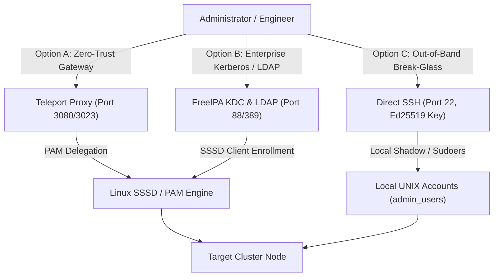
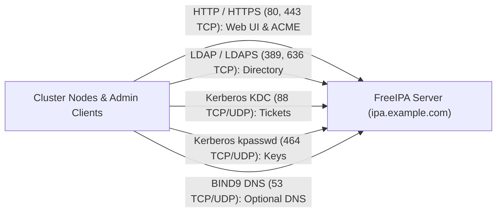

# FreeIPA Centralized Identity & Access Management

This document provides a comprehensive guide to deploying and integrating **FreeIPA** (Free Identity, Policy, and Audit) within the cluster as a modular alternative to **Teleport**.

---

## 1. Architectural Overview: Teleport vs. FreeIPA

The infrastructure supports two decoupled identity management architectures:

| Dimension | Teleport (`identity_provider: "teleport"`) | FreeIPA (`identity_provider: "freeipa"`) |
| :--- | :--- | :--- |
| **Primary Protocol** | Modern Zero-Trust SSH & Web Reverse Proxy | Kerberos (KDC), 389 Directory Server (LDAP), SSSD |
| **Authentication** | Short-lived X.509 & SSH Certificates + Web SSO | Kerberos tickets (`kinit`), LDAP credentials, OTP |
| **Client Software** | `teleport` agent daemon (Go binary) | Native Linux SSSD (`sssd`), Kerberos (`krb5`), PAM |
| **SSH Key Lookup** | Dynamic certificate validation by SSH agent | Centralized LDAP lookup via `sss_ssh_authorizedkeys` |
| **Access Control** | Declarative YAML RBAC with JIT Elevation | Host-Based Access Control (HBAC) & Centralized Sudo |
| **Network Boundary**| Single reverse proxy tunnel port (default 3080/3023)| Enterprise multi-port KDC (88), LDAP (389/636), UI (443)|
| **Best For** | Cloud-native, zero-trust perimeter, web console | Enterprise Kerberos/LDAP integration, POSIX environments |

---

## 2. Dual Identity Integration (`identity_provider: "both"`) & Break-Glass Access

Organizations with rigorous enterprise governance can run **both Teleport and FreeIPA simultaneously** alongside out-of-band Basic Auth:



### How Coexistence Operates:
1. **FreeIPA as POSIX & Directory Foundation**:
   FreeIPA manages host enrollment, central POSIX user IDs, LDAP groups, centralized sudo policies, and Kerberos tickets.
2. **Teleport as Edge Bastion & Audit Gateway**:
   Teleport acts as the boundary gateway. When an engineer connects via `tsh ssh`, Teleport authenticates the session, opens an encrypted reverse tunnel, and authenticates against the host's Linux PAM stack—which delegates user lookup to SSSD and FreeIPA.
3. **Emergency Break-Glass Access**:
   `roles/admin_users` unconditionally provisions local administrator accounts from `vars/admin_users.yml` on every cluster node with local Ed25519 SSH keys and sudo rights. If both Teleport and FreeIPA are offline or experiencing network isolation, administrators can still access nodes directly via console or out-of-band SSH.
4. **HTTP Basic Auth for Administrative Web UIs**:
   Administrative interfaces across HAProxy stats (`8404`), RabbitMQ Management UI (`15672`), and Grafana (`3000`) support native HTTP Basic Authentication protected by IP whitelists.

To enable dual deployment across all cluster nodes, set in `group_vars/all.yml` or your inventory:
```yaml
identity_provider: "both"
```

---

## 3. Standing Up a Dedicated FreeIPA Instance

When building a self-contained private cluster, you can provision a dedicated FreeIPA server on the `[freeipa_servers]` host group using the `freeipa_server` role.

### Network & Firewall Architecture

The FreeIPA server requires the following ports opened across internal cluster subnets (`freeipa_trusted_subnets`):



- **UFW Firewall**: Configured automatically by `roles/freeipa_server/tasks/firewall.yml`.
- **Web UI Protection**: Ingress through HAProxy or direct access to port 443 is strictly limited to `freeipa_admin_trusted_cidrs`.

### Deployment Steps

1. **Configure Vault Passwords**:
   In `group_vars/all/vault.yml`:
   ```yaml
   vault_freeipa_admin_password: "YourStrongAdminPassword2026!"
   vault_freeipa_ds_password: "YourDirectoryManagerPassword2026!"
   ```

2. **Define Server in Inventory**:
   In your inventory file (e.g., `examples/freeipa/inventory.standup.ini`):
   ```ini
   [freeipa_servers]
   ipa-01 ansible_host=10.0.1.70 external_fqdn=ipa.example.com

   [headless_nodes:vars]
   identity_provider=freeipa
   freeipa_deploy_server=true
   freeipa_domain=example.com
   freeipa_realm=EXAMPLE.COM
   ```

3. **Run Playbook**:
   ```bash
   ansible-playbook -i examples/freeipa/inventory.standup.ini \
     examples/freeipa/standup_freeipa_cluster.yml \
     --ask-vault-pass
   ```

---

## 4. Connecting to an Existing FreeIPA Instance

If your organization already operates an enterprise FreeIPA or Red Hat Directory Server (IdM) cluster, you can enroll the cluster nodes without provisioning a local FreeIPA server.

### Enrollment Methods

You can authenticate enrollment into the external domain using either a One-Time Password (OTP) or directory administrative credentials:

#### Method A: Pre-Generated One-Time Password (OTP) (Recommended)
Pre-creating the host entry on your external FreeIPA server generates an ephemeral enrollment secret:
```bash
# Execute on the existing FreeIPA server:
ipa host-add node-01.corp.example.com --password="TempHostJoinSecret2026!"
```

Pass the OTP to Ansible via Vault or variable override:
```yaml
freeipa_client_otp: "TempHostJoinSecret2026!"
```

#### Method B: Administrator Credentials
If cluster nodes should self-register as new hosts using directory administrator credentials:
```yaml
freeipa_admin_user: "admin"
freeipa_admin_password: "{{ vault_freeipa_admin_password }}"
```

### Deployment Steps

1. **Configure Inventory Variables**:
   In your inventory file (e.g., `examples/freeipa/inventory.existing.ini`):
   ```ini
   [headless_nodes:vars]
   identity_provider=freeipa
   freeipa_deploy_server=false

   # External FreeIPA Server Details
   freeipa_server_host=192.168.1.100
   freeipa_server_fqdn=idm.corp.example.com
   freeipa_domain=corp.example.com
   freeipa_realm=CORP.EXAMPLE.COM
   ```

2. **Run Enrollment Playbook**:
   ```bash
   ansible-playbook -i examples/freeipa/inventory.existing.ini \
     examples/freeipa/enroll_existing_freeipa.yml \
     --ask-vault-pass
   ```

---

## 5. Client SSSD, SSH & Sudo Integration

Once a node is enrolled, `roles/freeipa_client` automatically hardens the authentication stack:

### Centralized SSH Key Distribution
SSSD connects directly to LDAP to retrieve user SSH public keys. The role deploys `/etc/ssh/sshd_config.d/02-freeipa.conf`:
```
AuthorizedKeysCommand /usr/bin/sss_ssh_authorizedkeys
AuthorizedKeysCommandUser nobody
```
When an administrative user runs `ssh user@node`, `sshd` queries SSSD, which fetches the public key registered in FreeIPA without needing manual distribution to `/home/user/.ssh/authorized_keys`.

### Centralized Sudo Rules
SSSD is configured with the `sudo` responder in `/etc/sssd/sssd.conf`, and `/etc/nsswitch.conf` is updated with:
```
sudoers: files sss
```
Privilege escalation rules defined in FreeIPA (`ipa sudorule-add`) apply across the entire fleet in real time.

### Automatic Home Directory Provisioning
PAM auto-creates home directories upon first login using `oddjob-mkhomedir` and `pam-auth-update --enable mkhomedir`.

---

## 6. Verification & Troubleshooting

### Check Server Health
On the FreeIPA server node:
```bash
ipactl status
ipa-server-install --status
kinit admin
ipa user-find admin
```

### Check Client Enrollment & SSSD Status
On any enrolled cluster node:
```bash
# Check SSSD daemon status
systemctl status sssd

# Test user resolution from FreeIPA
id <username>

# Test SSH key retrieval via SSSD
/usr/bin/sss_ssh_authorizedkeys <username>

# Run SSSD diagnostic checks
sssctl domain-status <domain>
sssctl user-checks <username>
```

---

## 7. Playbook & Variable Reference

### Role Variables (`freeipa_server`)
| Variable | Default | Description |
| :--- | :--- | :--- |
| `freeipa_domain` | `domain_name` | DNS domain name (e.g., `example.com`) |
| `freeipa_realm` | Uppercase `freeipa_domain` | Kerberos realm (e.g., `EXAMPLE.COM`) |
| `freeipa_server_fqdn` | `ipa.{{ freeipa_domain }}` | FQDN of the FreeIPA server |
| `freeipa_setup_dns` | `false` | When `true`, configures integrated BIND9 DNS |
| `freeipa_setup_ntp` | `false` | When `false`, preserves systemd-timesyncd |
| `freeipa_trusted_subnets`| RFC 1918 subnets | CIDRs allowed to authenticate via Kerberos/LDAP |
| `freeipa_admin_trusted_cidrs`| `admin_trusted_cidrs` | CIDRs allowed to access the FreeIPA Web UI |

### Role Variables (`freeipa_client`)
| Variable | Default | Description |
| :--- | :--- | :--- |
| `freeipa_server_fqdn` | `ipa.{{ freeipa_domain }}` | Target FreeIPA server FQDN |
| `freeipa_server_host` | First host in `[freeipa_servers]` | IP address of target FreeIPA server |
| `freeipa_client_otp` | `""` | One-Time Password for host enrollment |
| `freeipa_admin_user` | `"admin"` | Administrative principal if OTP is not used |
| `freeipa_enable_ssh_keys`| `true` | Enables `sss_ssh_authorizedkeys` in sshd |
| `freeipa_enable_sudo` | `true` | Enables centralized sudo rules via SSSD |
| `freeipa_enable_mkhomedir`| `true` | Automatically provisions user home directory |
