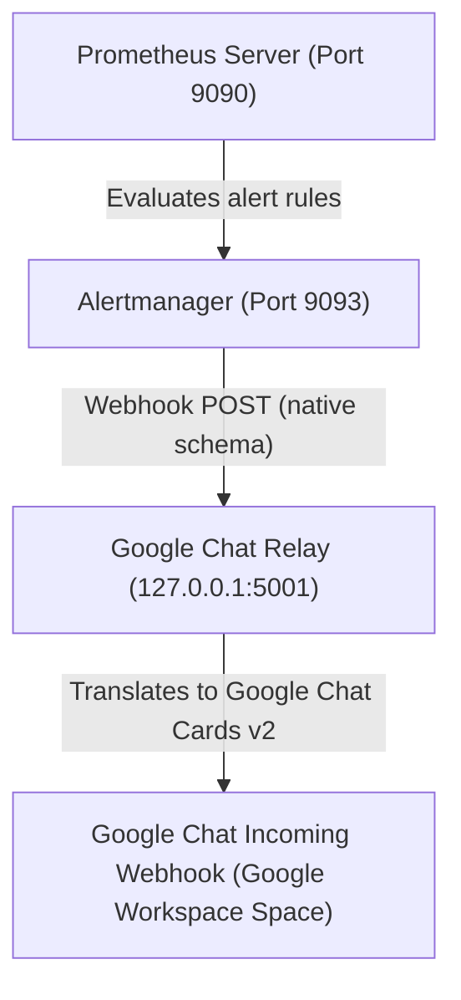

# Google Chat Integration for Alertmanager

## Overview

Google Chat spaces accept incoming notifications via **Incoming Webhooks**. However, unlike Slack, Google Chat requires payloads to follow a specific JSON structure (`{"text": "..."}` or `{"cardsV2": [...]}`). Because Prometheus Alertmanager emits its own standardized webhook payload schema, a lightweight relay or translator is positioned between Alertmanager and Google Chat.

This guide details how to integrate Alertmanager with Google Chat using the automated `roles/prometheus_server` configuration and the zero-dependency Python relay script provided in [`examples/alertmanager/google_chat_relay.py`](../examples/alertmanager/google_chat_relay.py).

---

## Architecture



---

## Step 1: Create a Google Chat Webhook

1. Open **Google Chat** (or Gmail) and navigate to the Space where you want to receive alerts.
2. Click the Space name at the top to open the dropdown menu.
3. Select **Apps & integrations** (or **Manage webhooks**).
4. Click **Add webhooks**.
5. Set the webhook name (e.g., `Cluster Alertmanager`) and an avatar URL (e.g., `https://prometheus.io/assets/prometheus_logo_grey.svg`).
6. Click **Save** and copy the generated Webhook URL:
   ```
   https://chat.googleapis.com/v1/spaces/AAAAxxxxxx/messages?key=AIzaSy...&token=...
   ```

---

## Step 2: Configure Automated Deployment in Ansible

When `alertmanager_google_chat_webhook_url` is non-empty, `roles/prometheus_server` automatically handles everything on your `[monitoring]` node:

1. **Deploys the relay binary**: Installs [`examples/alertmanager/google_chat_relay.py`](../examples/alertmanager/google_chat_relay.py) to `/usr/local/bin/alertmanager-google-chat-relay`.
2. **Manages the systemd service**: Configures and starts `alertmanager-google-chat-relay.service` listening on `127.0.0.1:{{ alertmanager_google_chat_relay_port }}` (default `5001`).
3. **Wires Alertmanager webhook routing**: Adds the local relay webhook to `/etc/prometheus/alertmanager.yml`, forwarding both standard Prometheus cluster alerts (with `send_resolved: true`) and immediate `TeleportSudoAccessRequestPending` (`tsudo`) approval requests (`group_wait: 0s`) to Google Chat.

Set the webhook URL in `group_vars/monitoring.yml` (or override via Ansible Vault):

```yaml
# In group_vars/monitoring.yml or group_vars/all/vault.yml:
alertmanager_google_chat_webhook_url: "https://chat.googleapis.com/v1/spaces/YOUR_SPACE/messages?key=YOUR_KEY&token=YOUR_TOKEN"
alertmanager_google_chat_relay_port: 5001
```

Apply the configuration to your monitoring node:

```bash
ansible-playbook -i inventory.ini playbook.yml --tags alertmanager
```

### Testing Standalone Locally
To test the relay script locally before deploying:
```bash
export GCHAT_WEBHOOK_URL="https://chat.googleapis.com/v1/spaces/YOUR_SPACE/messages?key=YOUR_KEY&token=YOUR_TOKEN"
python3 examples/alertmanager/google_chat_relay.py 5001
```

*(For manual non-Ansible setups or custom routing trees, a standalone example configuration is also available in [`examples/alertmanager/alertmanager-google-chat.yml`](../examples/alertmanager/alertmanager-google-chat.yml).)*

---

## Step 3: Verification & Message Format

Send a test alert from your monitoring server to verify end-to-end delivery:

```bash
curl -X POST http://127.0.0.1:5001/ -H "Content-Type: application/json" -d '{
  "status": "firing",
  "commonLabels": {
    "alertname": "TestAlert",
    "cluster": "production",
    "severity": "critical"
  },
  "commonAnnotations": {
    "summary": "Synthetic Verification Alert",
    "description": "Verifying Google Chat webhook delivery from Prometheus Alertmanager."
  },
  "alerts": [
    {
      "status": "firing",
      "labels": {
        "instance": "proxy-01:8404"
      },
      "startsAt": "2026-11-15T12:00:00Z"
    }
  ]
}'
```

### Visual Appearance in Google Chat
The relay formats alerts using **Google Chat Cards v2**:
- **Header**: `🚨 [FIRING] TestAlert` or `✅ [RESOLVED] TestAlert`
- **Subtitle**: `Cluster: production | Severity: CRITICAL`
- **Sections**: Detailed alert summary, description, and list of impacted host instances.
- **Interactive Action Button**: For `TeleportSudoAccessRequestPending` (`tsudo`) access requests carrying an `approval_url` annotation, renders an **Approve / Review in Teleport Web UI** button linking directly to the request approval page.
