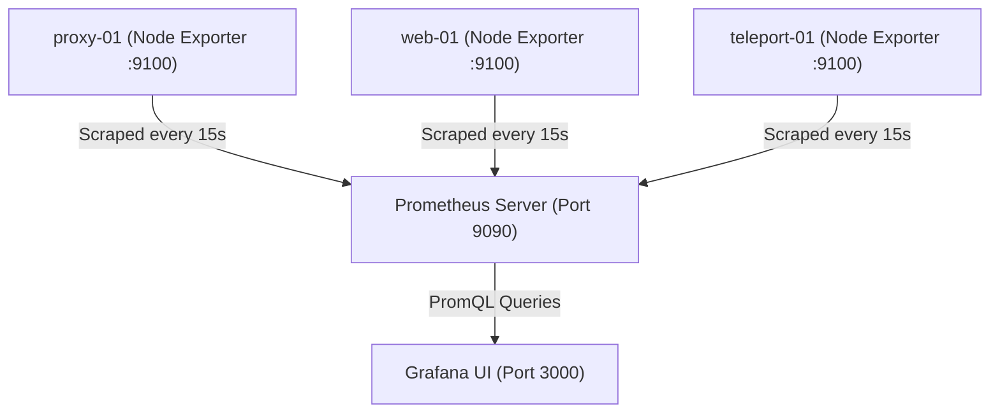

# Grafana Telemetry & Hardware Observability

## Overview

The cluster incorporates an end-to-end telemetry stack featuring:
1. **Node Exporter (`node_exporter`)**: Lightweight hardware and OS metrics collector deployed across every cluster host on port `9100`.
2. **Prometheus Server (`prometheus_server`)**: Centralized time-series database scraping HAProxy ingress metrics, Coraza WAF events, and host telemetry.
3. **Grafana Server (`grafana`)**: Enterprise-grade visualization platform pre-configured with automated datasource provisioning and curated operational dashboards on port `3000`.

---

## Architecture & Data Flow

---

## Pre-Configured Dashboards

Grafana automatically provisions two production dashboards from JSON templates into `/var/lib/grafana/dashboards`:

### 1. HAProxy & Coraza WAF Overview (`haproxy_waf_overview.json`)
- **Frontend Request Rates**: Real-time traffic volume (requests/sec) segmented across HTTP frontends.
- **Active Connections**: Current concurrent sessions and session capacity saturation.
- **HTTP Status Breakdown**: Ingress error distribution highlighting 4xx client errors and 5xx backend server faults.
- **Security Interceptions & WAF Blocks**: Rate of requests blocked or dropped by the Coraza Web Application Firewall and IP stick-table rate limiters.

### 2. Fleet Hardware Health (`fleet_hardware_health.json`)
- **Cluster CPU Utilization**: Multi-core CPU consumption across proxy, webserver, teleport, and monitoring instances.
- **Memory Pressure**: Active RAM and swap utilization per node.
- **Root Filesystem Usage**: Disk consumption on `/` preventing disk-full outages.
- **Network I/O Throughput**: Ingress and egress network bandwidth per interface.

---

## Role Variables & Customization

The `grafana` role can be tuned in `group_vars/monitoring.yml` or `group_vars/all/vault.yml`:

| Variable | Default | Description |
| :--- | :--- | :--- |
| `enable_grafana` | `true` | Toggle Grafana provisioning on monitoring nodes. |
| `grafana_port` | `3000` | HTTP listening port for the Grafana web UI. |
| `grafana_domain` | `"localhost"` | Hostname or FQDN for the Grafana server. |
| `grafana_admin_user` | `"admin"` | Initial administrative username. |
| `grafana_admin_password` | `vault_grafana_admin_password` | Master administrative password (protected in Ansible Vault). |
| `grafana_prometheus_url` | `"http://127.0.0.1:9090"` | Upstream Prometheus server connection URL. |
| `grafana_trusted_subnets`| RFC1918 + loopback | List of IP subnets allowed to access the Grafana UI. |

---

## Accessing Grafana

1. Open a browser to `http://<monitoring_host_ip>:3000/`.
2. Authenticate using the configured `grafana_admin_user` and `vault_grafana_admin_password`.
3. Navigate to **Dashboards** to view the auto-provisioned **HAProxy & Coraza WAF Overview** and **Fleet Hardware Health** dashboards.
