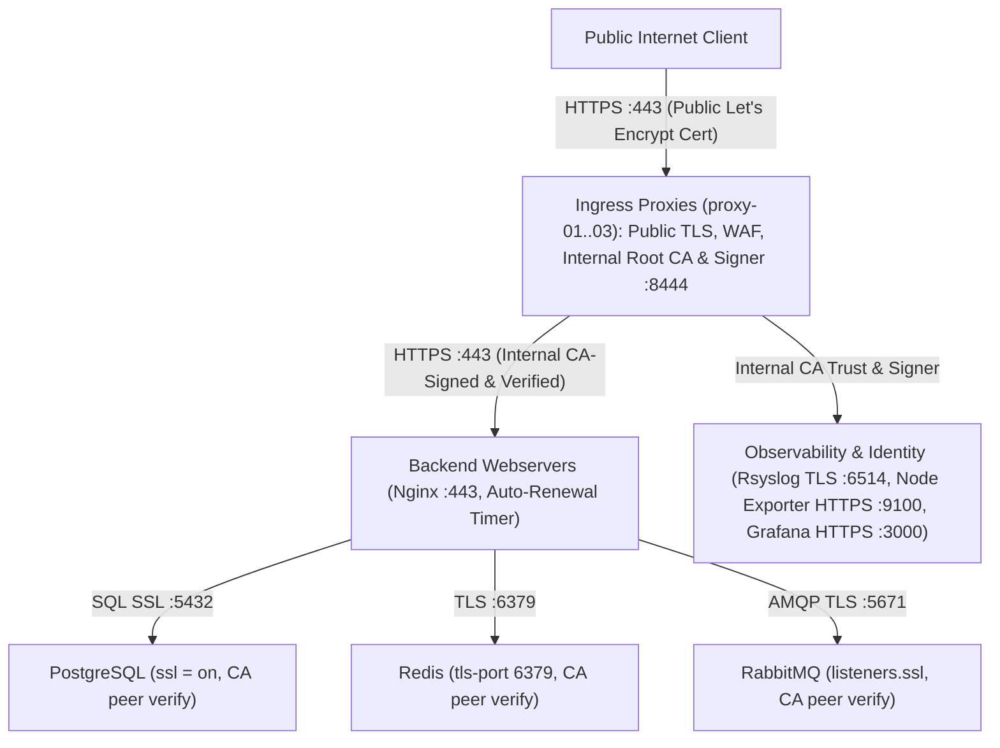

# Zero-Trust Internal TLS Encryption & Replicated Lightweight CA

## Overview

In traditional cloud and enterprise topologies, SSL termination occurs at the edge load balancer, leaving internal transit between the load balancer and backend web servers unencrypted over plaintext HTTP (port 80) or unverified with opportunistic self-signed certificates (`ssl verify none`).

To satisfy strict Zero-Trust and compliance mandates (e.g., **NIST SP 800-207**, **PCI-DSS 4.0**, **SOC 2**, **HIPAA**), this architecture provides a **production-grade, fully automated Internal Certificate Authority (CA)**:
1. **Lightweight ECDSA P-384 Root CA on `proxy-01`**: A high-assurance Elliptic Curve Root Certificate Authority (`secp384r1` curve with SHA-384, delivering 192 bits of symmetric cryptographic equivalent strength—surpassing RSA-4096) is initialized on the primary proxy (`cert_primary_host`).
2. **Cluster-Wide CA Replication**: The internal CA root certificate, key, and serial tracker are automatically replicated across all peer proxies using dedicated cluster SSH keys (`sync-haproxy-certs.sh`).
3. **Strict Cryptographic Peer Verification by Default**: When internal TLS is enabled, `haproxy_backend_ssl_verify: "required"` is the default. HAProxy strictly authenticates every backend server against `/etc/haproxy/certs/internal-ca.crt`.
4. **Rank-Based Line of Succession Failover**: Backend webservers request and auto-renew certificates via an internal signing API on port `8444`. If `proxy-01` is down or unreachable, clients automatically fall back to `proxy-02`, `proxy-03`, etc., using the exact same succession rules as external certificate renewal.
5. **Zero-Ansible-Interaction Auto-Renewals**: Both leaf certificates (14-day renewal threshold) and the CA root certificate (30-day renewal threshold) automatically renew on systemd timers without requiring any manual or Ansible intervention.
6. **Zero Intermediate Outage Orchestration**: Staged provisioning guarantees that internal CA authority and backend Nginx TLS are fully established before HAProxy activates strict `verify required` health checks.
7. **Proactive Prometheus & Alertmanager Monitoring**: Expiration metrics are collected by Prometheus Node Exporter, firing warning alerts at 14 days and critical alerts at 3 days.

---

## Traffic Flow & Cryptographic Verification



---

## Fleet-Wide Zero-Trust Architecture (`enable_internal_tls: true`)

When `enable_internal_tls: true` is enabled in `group_vars/all.yml` or passed via command line, the `internal_ca_client` role automatically enrolls **every node across the entire fleet** into the internal PKI:
1. **OS-Level Trust Anchor**: Installs `/etc/ssl/certs/internal-ca.crt` and updates the Linux system trust store (`/usr/local/share/ca-certificates/cluster-internal-ca.crt` + `update-ca-certificates`). All native Linux tools (`curl`, Python, Go, Java, Rsyslog, Prometheus) automatically trust the internal CA.
2. **Node Leaf Certificates**: Generates a 90-day ECDSA P-384 leaf certificate (`/etc/ssl/internal/server.crt` and `server.key`) signed by the internal CA with SANs matching the node's hostname, internal IP, and FQDN.
3. **Automated Lifecycle Management**: Manages automated renewal via `renew-internal-cert.timer` with 14-day pre-expiry triggers and automatic service reloads.
4. **End-to-End Encrypted Protocols**:
   * **Central Logging**: Rsyslog forwards system, proxy, and app logs over encrypted TLS on port `6514` (GnuTLS) with CA verification.
   * **Telemetry Scraping**: Node Exporter exposes metrics over HTTPS (`--web.config.file`) on port `9100`; Prometheus scrapes via `scheme: https` validating against `internal-ca.crt`.
   * **Database Transit**: PostgreSQL enforces `ssl = on` requiring internal TLS for webserver queries and streaming replication.
   * **Cache & Queue Transit**: Redis and RabbitMQ bind TLS listeners, securing sessions, caches, and message queues in-flight.

---

## Configuration Reference

### 1. In `roles/proxy/defaults/main.yml` (or `group_vars/proxies.yml`):
```yaml
# Enable SSL re-encryption on upstream connections to webserver backends
haproxy_backend_ssl: true

# Verification mode: "required" with internal CA (default), or "none"
haproxy_backend_ssl_verify: "required"
haproxy_backend_ca_file: "/etc/haproxy/certs/internal-ca.crt"

# Internal CA settings (ECDSA P-384 / secp384r1)
enable_internal_ca: true
internal_ca_dir: "/etc/ssl/internal/ca"
internal_ca_signer_port: 8444
internal_ca_curve: "secp384r1"
internal_ca_digest: "sha384"
internal_ca_validity_days: 730
internal_ca_renewal_threshold_days: 30
internal_ca_leaf_validity_days: 90
internal_cert_renewal_threshold_days: 14
```

### 2. In `roles/webserver/defaults/main.yml` (or `group_vars/webservers.yml`):
```yaml
# Enable HTTPS on backend Nginx instances (inherits from global enable_internal_tls)
webserver_enable_ssl: "{{ enable_internal_tls | default(false) | bool }}"
webserver_ssl_cert_dir: "/etc/ssl/internal"
webserver_ssl_cert: "/etc/ssl/internal/server.crt"
webserver_ssl_key: "/etc/ssl/internal/server.key"
webserver_ssl_ca_cert: "/etc/ssl/certs/internal-ca.crt"

# Automated Certificate Renewal Configuration (ECDSA P-384)
webserver_ssl_curve: "secp384r1"
webserver_ssl_digest: "sha384"
internal_cert_renewal_threshold_days: 14
internal_ca_signer_port: 8444
```

### 3. In `group_vars/all/vault.yml`:
```yaml
# Shared authorization token for internal CA signing requests
vault_internal_ca_token: "YourSecretInternalCAToken2026!"
```

---

## Autonomous Lifecycle & Failover Mechanisms

### 1. Leaf Certificate Auto-Renewal & Proxy Failover (`renew-internal-cert.sh`)
Backend webservers and fleet nodes execute `/usr/local/bin/renew-internal-cert.sh` via the `renew-internal-cert.timer` systemd timer:
1. **Threshold Assessment**: Evaluates `/etc/ssl/internal/server.crt`. If remaining validity is ≤ 14 days (or cert is missing), renewal initiates.
2. **CSR Generation**: Generates an ECDSA P-384 private key (`secp384r1`, if missing) and CSR containing complete Subject Alternative Names signed with SHA-384:
   ```
   DNS:web1.example.com, DNS:web-01, IP:10.0.1.11
   ```
3. **Rank-Based Succession Failover**:
   The client iterates through all proxies in configured priority order (`proxy-01`, then `proxy-02`, then `proxy-03`):
   ```bash
   # Checks health endpoint first:
   curl -s http://10.0.1.10:8444/health
   # If healthy, submits CSR:
   curl -s -X POST -H "Content-Type: application/json" -d '{"csr": "...", "hostname": "web-01", "token": "..."}' http://10.0.1.10:8444/sign
   ```
   - If `proxy-01` is offline or fails, the client logs a warning and immediately falls back to `proxy-02`.
   - Once signed, the certificate is installed at `/etc/ssl/internal/server.crt`, the latest CA root is fetched from `/ca.crt` to `/etc/ssl/certs/internal-ca.crt` and updated in the OS trust store, and active TLS services (Nginx, Rsyslog, Node Exporter) are reloaded gracefully.

### 2. Root CA Auto-Renewal & Simultaneous Renewal Prevention (`renew-internal-ca.sh`)
To guarantee that proxies never renew the root CA simultaneously or create divergent certificates, renewal employs a multi-tiered authority and watchdog model:

1. **Primary Authority Designation (`proxy-01`)**:
   - `cert_primary_host` (`proxy-01`) is the designated Primary CA Authority.
   - Executes `/usr/local/bin/renew-internal-ca.sh` twice daily via `renew-internal-ca.timer`.
   - Evaluates `/etc/ssl/internal/ca/cluster-ca.crt`. When remaining validity is ≤ 30 days (`internal_ca_renewal_threshold_days`), `proxy-01` self-re-signs the Root CA with a fresh 730-day window (`VALIDITY_DAYS=730`) while preserving key integrity.
   - Updates `/etc/haproxy/certs/internal-ca.crt`, restarts local `internal-ca-signer`, reloads local HAProxy, and executes `/usr/local/bin/sync-haproxy-certs.sh` to mirror the renewed CA across all peer proxies.

2. **Standby Watchdog Mode on Replicas (`proxy-02`, `proxy-03`, ...)**:
   - Replica proxies execute `renew-internal-ca.sh` in **standby watchdog mode**.
   - **Staggered Fallback Window**: Replicas ignore the 30-day threshold and evaluate an emergency fallback threshold (`internal_ca_fallback_renewal_days`, default: 15 days) staggered by 1 day per replica rank offset (`proxy-02` = 15d, `proxy-03` = 14d, etc.).
   - **Liveness Probing**: Even if the emergency threshold is reached, a replica will **never** renew if any higher-priority proxy is alive. It probes higher-priority proxies via ICMP, port 8444 HTTP `/health`, and SSH keyscan. Only if **all** higher-priority proxies are confirmed unreachable will the standby replica take over CA renewal and propagate it to surviving peers.

3. **Concurrency Locks & Deterministic Rank-Based Offsets**:
   - **File Lock**: Local executions acquire an exclusive non-blocking lock (`flock`) on `/var/lock/internal-ca-renewal.lock` to prevent overlapping runs on the same node.
   - **Deterministic Rank-Based Schedule**: Rather than relying on non-deterministic random jitter, `renew-internal-ca.timer` schedules execution based on the proxy's cluster rank (`internal_ca_timer_rank_offset_minutes`, default: 10 minutes):
     - `proxy-01` (Rank 0): `02:00:00` and `14:00:00`
     - `proxy-02` (Rank 1): `02:10:00` and `14:10:00` (+10m)
     - `proxy-03` (Rank 2): `02:20:00` and `14:20:00` (+20m)
     This deterministic spacing guarantees that the primary authority runs first, completes renewal, and replicates the new certificate to peers before any replica timer elapses.

4. **Boot-Time Reconciliation & Adoption (`check-and-adopt-cluster-certs.sh`)**:
   - If `proxy-01` suffers an extended outage during which `proxy-02` performed an emergency CA renewal, `proxy-01` will not blindly renew or revert the CA upon rebooting.
   - The boot-time service (`haproxy-cert-reconcile.service`) queries peer proxies for `/etc/ssl/internal/ca/cluster-ca.crt` expiration epochs. Seeing that `proxy-02` holds a newer CA, `proxy-01` automatically adopts `proxy-02`'s newer CA, updates HAProxy, and resumes its primary rank seamlessly.

---

## Non-Destructive Ansible Runs & Out-of-Band Safety

Because certificate renewals occur continuously and autonomously on systemd timers without Ansible interaction, the Ansible roles are engineered to be **100% non-destructive and idempotent**:

1. **Root CA State Preservation**:
   - In `roles/proxy/tasks/internal_ca.yml`, Ansible inspects `/etc/ssl/internal/ca/cluster-ca.crt` via `stat`.
   - CA generation (`openssl req`) runs strictly `when: not internal_ca_stat.stat.exists`. Once a CA exists (or has been renewed out-of-band), Ansible **never regenerates or overwrites** it.
   - CA slurping and distribution across proxies runs strictly for uninitialized nodes lacking CA files (`when: not internal_ca_stat.stat.exists`). Existing proxies keep their active certificates untouched.
   - HAProxy's trust copy (`/etc/haproxy/certs/internal-ca.crt`) is maintained locally from the host's own active `/etc/ssl/internal/ca/cluster-ca.crt`.

2. **Webserver & Node Leaf Certificate Preservation**:
   - In `roles/internal_ca_client/tasks/main.yml` and `roles/webserver/tasks/tls.yml`, Ansible inspects `/etc/ssl/internal/server.crt` via `stat`.
   - Initial CA signing (`/usr/local/bin/renew-internal-cert.sh --force`) executes strictly `when: not internal_cert_stat.stat.exists` (or `not node_cert_stat.stat.exists`).
   - If a valid or auto-renewed certificate is already present, Ansible skips certificate issuance entirely.

3. **Zero Configuration Drift or Clashes**:
   - Administrators can safely run `playbook.yml` at any time (for package updates, user management, or firewall changes) without interrupting automated renewal timers, invalidating serial trackers, or reverting active certificates.

---

## Outage Prevention & Staged Provisioning Order

To prevent false-positive HAProxy health check drops when standing up new servers or spinning up clusters:
1. **Stage 1 (Proxies)**: Initial CA root is generated on `proxy-01`, replicated to all peer proxies, and the `internal-ca-signer` daemon starts on port `8444`.
2. **Stage 2 (Fleet & Webservers)**: Cluster nodes and webservers request their initial certificate from the active proxy CA, establish `/etc/ssl/internal/server.crt`, and start Nginx on port `443`.
3. **Stage 3 (Proxies)**: HAProxy is configured with `ssl verify required ca-file /etc/haproxy/certs/internal-ca.crt` and starts/reloads.

Because backend webservers are already serving valid HTTPS when HAProxy begins health checks, upstream verification passes on the very first probe with zero dropped client connections.

---

## Prometheus Alerting & Telemetry

Prometheus Node Exporter collects certificate expiration timestamps via textfile metrics written by the renewal scripts:
- Metric: `x509_cert_expiry_timestamp_seconds{cert_name="...", cert_path="...", role="ca|leaf"}`

The Prometheus alerting rules in `roles/prometheus_server/templates/alert.rules.yml.j2` evaluate:
- **`InternalTLSCertificateExpiringSoon`** (`warning`): Fires if an internal certificate or CA expires in less than **14 days**.
- **`InternalTLSCertificateExpirationCritical`** (`critical`): Fires if an internal certificate expires in less than **3 days**.

Notifications are automatically dispatched via Alertmanager to the configured admin email and notification webhooks.

---

## Verification & Diagnostics

### 1. Test Proxy Signing Service & CA Download
From any cluster node on the private subnet:
```bash
# Check signer health
curl -s http://10.0.1.10:8444/health

# Download internal CA root
curl -s http://10.0.1.10:8444/ca.crt | openssl x509 -text -noout
```

### 2. Verify Client Certificate Expiration & Renewal
On any fleet node or backend webserver:
```bash
# Check current certificate expiration
openssl x509 -enddate -noout -in /etc/ssl/internal/server.crt

# Force manual renewal test against proxy succession line
/usr/local/bin/renew-internal-cert.sh --force
```

### 3. Verify HAProxy Strict TLS Handshake
From an ingress proxy:
```bash
# Verify TLS handshake with strict CA verification
openssl s_client -connect 10.0.1.11:443 -CAfile /etc/haproxy/certs/internal-ca.crt -servername web1.example.com
```

---

## Configuration Examples

For complete group variable templates and reference configurations:
- [enable_internal_tls_vars.yml](../examples/internal-tls/enable_internal_tls_vars.yml): Ready-to-use variables file for proxies and webservers.
- [internal-tls Example README](../examples/internal-tls/README.md): Quickstart setup and testing guide.
