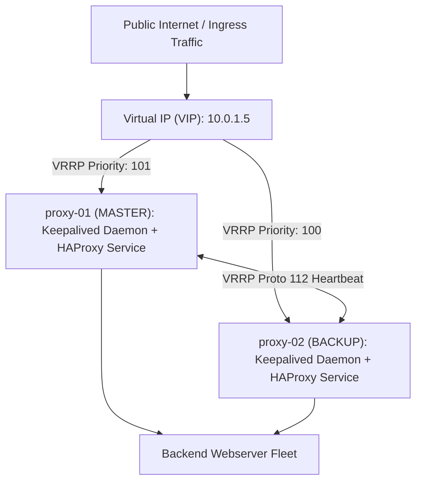

# Bare Metal High Availability with Keepalived VRRP

## Overview

In bare metal, on-premises, or private cloud environments (such as Equinix Metal, OVHcloud, Hetzner, or private data centers), cloud native load balancer primitives (e.g., AWS NLB/ALB, GCP Cloud Load Balancing) are unavailable. 

To achieve zero single points of failure at the network ingress layer, this project provides the `keepalived` role. Keepalived implements the **Virtual Router Redundancy Protocol (VRRP)** (RFC 5798), assigning a shared Virtual IP (VIP) across active-passive HAProxy proxy pairs.

---

## Architecture



- **Health Check Tracking**: Keepalived runs an automated health-check probe `/usr/local/bin/check_haproxy.sh` every 2 seconds.
- **Failover Trigger**: If HAProxy fails or stops responding on the MASTER node, the health script exits with code `1`, dropping the VRRP priority by `20`. The BACKUP node immediately takes ownership of the VIP with zero TCP connection drops.
- **Failback Preemption**: Configurable preemption (`nopreempt` toggle) ensures traffic does not unnecessarily flap back to a recovered node until stability is confirmed.

---

## Role Configuration Variables

Variables can be customized in `group_vars/proxies.yml` or `inventory.ini`:

| Variable | Default | Description |
| :--- | :--- | :--- |
| `enable_keepalived` | `false` | Master toggle to enable or disable Keepalived on proxies. |
| `keepalived_interface` | `ansible_default_ipv4.interface` | Network interface to bind the VRRP instance to (e.g. `eth0`). |
| `keepalived_vip` | `"10.0.1.5"` | Shared Virtual Floating IPv4 address. |
| `keepalived_vip_cidr` | `24` | Subnet mask bits for the VIP. |
| `keepalived_virtual_router_id` | `51` | VRRP Virtual Router ID (`1` - `255`). Must match across peers. |
| `keepalived_priority_master` | `101` | VRRP priority for the primary proxy node. |
| `keepalived_priority_backup` | `100` | VRRP priority for secondary proxy nodes. |
| `keepalived_auth_pass` | `"VrrpSecretPass2026"` | Authentication secret for VRRP packet exchange. |
| `keepalived_advert_int` | `1` | VRRP advertisement interval in seconds. |
| `keepalived_nopreempt` | `true` | Prevents flapping back to primary if primary recovers. |

---

## Operating System & Kernel Tuning

The role automatically tunes Linux kernel sysctl parameters in `/etc/sysctl.d/99-keepalived.conf`:

```ini
# Allow binding and listening on IPs that do not currently belong to the local host
net.ipv4.ip_nonlocal_bind = 1
net.ipv6.ip_nonlocal_bind = 1

# Enable IP forwarding across interfaces
net.ipv4.ip_forward = 1
net.ipv6.conf.all.forwarding = 1
```

This permits HAProxy to start and bind to `keepalived_vip:80` and `keepalived_vip:443` on both the MASTER and BACKUP nodes simultaneously before failover occurs.

---

## Firewall (UFW) Integration

VRRP uses IP Protocol number `112` (not standard TCP/UDP). The role automatically configures UFW rules on all proxy nodes to permit bidirectional VRRP traffic between designated cluster peers:

```bash
ufw allow proto vrrp from <peer_ip> comment "Allow VRRP Keepalived traffic"
```

---

## Operational Verification

To inspect active VRRP state on any proxy node:

```bash
# Verify Keepalived service state
systemctl status keepalived

# Check whether the VIP is currently bound to the local interface
ip addr show dev eth0 | grep 10.0.1.5

# View real-time failover syslog events
journalctl -u keepalived -f
```

---

## 7. Bare Metal SSL Certificate Orchestration & VRRP Ingress

On bare metal clusters without cloud-managed load balancers, the Keepalived Virtual IP (VIP) seamlessly orchestrates Let's Encrypt SSL issuance and renewals:

1. **Inbound HTTP-01 Validation**:
   - Inbound ACME verification requests (`/.well-known/acme-challenge/*`) resolve to the Keepalived VIP (`keepalived_vip:80`).
   - The active MASTER proxy receives the connection and forwards the request to `backend be_acme` (pointing to the primary certificate node on port `8888`).
2. **Failover Resilience**:
   - If `proxy-01` fails, Keepalived transfers ownership of the VIP to `proxy-02` with zero packet loss.
   - If an SSL certificate expires while `proxy-01` is offline, `proxy-02`'s standby watchdog takes over renewal authority after its 1-day staggered grace period, renewals succeed through the VIP, and `sync-haproxy-certs.sh` distributes the fresh `.pem` bundle across the local subnet.
3. **Optional Wildcard Certificates via DNS APIs (Cloudflare, DNSimple, RFC 2136)**:
   - For bare-metal or on-premises environments with public domains managed on DNS providers like **Cloudflare** (`dns_cf`), **DNSimple** (`dns_dnsimple`), or **Porkbun** (`dns_porkbun`), you can enable DNS-01 wildcard certificates (`*.domain.com`) without opening port 8888.
   - For private air-gapped or internal enterprise networks, configure RFC 2136 (`dns_nsupdate`) pointing to your internal **BIND9** or **PowerDNS** server with TSIG keys.
   - See [ssl-certificates.md](ssl-certificates.md) for full configuration snippets.
