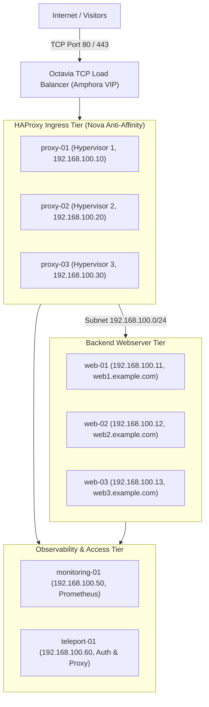

# OpenStack Quickstart & Provisioning Guide

This step-by-step guide is designed for new users deploying this high-availability suite onto **OpenStack** clouds. It covers installing and configuring the OpenStack CLI, configuring authentication via `clouds.yaml`, provisioning tenant networking, Nova anti-affinity server groups, security groups, and virtual instances via Ansible playbooks, and running the primary cluster configuration.

---

## 1. High-Level OpenStack Architecture

On OpenStack, the architecture isolates frontend proxies across separate physical hypervisors using a Nova `anti-affinity` server group behind an Octavia Load Balancer (or Keepalived VIP):



---

## 2. Installing the OpenStack CLI

Install the official OpenStack client using Python:

```bash
# Ubuntu / Debian prerequisites:
sudo apt-get update && sudo apt-get install -y python3-pip python3-dev

# Install OpenStack Client:
pip install python-openstackclient
```

### Verify Installation
```bash
openstack --version
```

---

## 3. Authenticating with OpenStack (`clouds.yaml`)

The recommended authentication mechanism is a declarative `clouds.yaml` file located at `~/.config/openstack/clouds.yaml` or `/etc/openstack/clouds.yaml`:

```yaml
# ~/.config/openstack/clouds.yaml
clouds:
  openstack:
    auth:
      auth_url: "https://keystone.example.com:5000/v3"
      username: "YOUR_USERNAME"
      password: "YOUR_PASSWORD"
      project_name: "YOUR_PROJECT_NAME"
      user_domain_name: "Default"
      project_domain_name: "Default"
    region_name: "RegionOne"
    identity_api_version: 3
```

### Verify Authentication
```bash
openstack --os-cloud openstack token issue
```

---

## 4. SSH Key Setup for OpenStack Instances

```bash
# Generate a modern ED25519 key pair if you do not already have one:
ssh-keygen -t ed25519 -f ~/.ssh/id_ed25519 -C "ubuntu"

# Import public key into OpenStack Nova:
openstack --os-cloud openstack keypair create \
  --public-key ~/.ssh/id_ed25519.pub \
  cluster-key
```

---

## 5. Preparing the Local Ansible Environment

Install `openstacksdk` and the Ansible collection:

```bash
pip install openstacksdk
ansible-galaxy collection install openstack.cloud
```

---

## 6. Provisioning OpenStack Infrastructure with Ansible

The suite provides a complete OpenStack provisioning playbook in `examples/provisioning/`:

- [examples/provisioning/vars_openstack.yml](../examples/provisioning/vars_openstack.yml)
- [examples/provisioning/provision_openstack.yml](../examples/provisioning/provision_openstack.yml)
- [examples/provisioning/deprovision_openstack.yml](../examples/provisioning/deprovision_openstack.yml)

### Step 6.1: Run the Playbook
```bash
ansible-playbook examples/provisioning/provision_openstack.yml
```

### What This Playbook Creates:
1. **Nova Anti-Affinity Server Group (`proxy-anti-affinity`)**: Ensures `proxy-01`, `proxy-02`, and `proxy-03` run on physically separate hypervisors.
2. **Neutron Network & Subnet**: `cluster-net` with `192.168.100.0/24`.
3. **Neutron Router (`cluster-router`)**: Connected to the provider's external public network.
4. **Security Group (`cluster-secgroup`)**: Ingress rules for SSH (22), HTTP (80), HTTPS (443), Teleport (3080/3023/3024), and internal subnet mesh.
5. **8 Ubuntu 22.04 LTS Compute Instances**:
   - `proxy-01` (`192.168.100.10`, anti-affinity)
   - `proxy-02` (`192.168.100.20`, anti-affinity)
   - `proxy-03` (`192.168.100.30`, anti-affinity)
   - `web-01` (`192.168.100.11`, FQDN: `web1.example.com`)
   - `web-02` (`192.168.100.12`, FQDN: `web2.example.com`)
   - `web-03` (`192.168.100.13`, FQDN: `web3.example.com`)
   - `monitoring-01` (`192.168.100.50`, Prometheus)
   - `teleport-01` (`192.168.100.60`, Teleport Auth/Proxy)
6. **Inventory Generation**: Updates `examples/inventories/inventory.openstack.ini`.

---

## 7. Alternative: Provisioning via OpenStack CLI Shell Script

If you prefer provisioning directly with `openstack` shell commands:

```bash
export OS_CLOUD="openstack"
./examples/provisioning/create_openstack_instances.sh
```

---

## 8. Deploying the Cluster Suite

### Step 8.1: Test Node Connectivity
```bash
ansible -i examples/inventories/inventory.openstack.ini -m ping all
```

### Step 8.2: Run Syntax Check
```bash
ansible-playbook -i examples/inventories/inventory.openstack.ini playbook.yml --syntax-check
```

### Step 8.3: Execute Full Cluster Provisioning
```bash
ansible-playbook -i examples/inventories/inventory.openstack.ini playbook.yml
```

---

## 9. Creating the OpenStack Octavia Load Balancer

To front the proxies with an Octavia Layer 4 load balancer:

```bash
# 1. Create Octavia Load Balancer on the public VIP subnet:
openstack loadbalancer create --name cluster-lb --vip-network-id public

# 2. Create TCP Listeners for Ports 80 & 443:
openstack loadbalancer listener create --name listener-tcp80 --protocol TCP --protocol-port 80 cluster-lb
openstack loadbalancer listener create --name listener-tcp443 --protocol TCP --protocol-port 443 cluster-lb

# 3. Create Backend Pools:
openstack loadbalancer pool create --name pool-tcp80 --lb-algorithm ROUND_ROBIN --listener listener-tcp80 --protocol TCP
openstack loadbalancer pool create --name pool-tcp443 --lb-algorithm ROUND_ROBIN --listener listener-tcp443 --protocol TCP

# 4. Add Proxies as Pool Members:
for IP in 192.168.100.10 192.168.100.20 192.168.100.30; do
  openstack loadbalancer member create --subnet-id cluster-subnet --address "${IP}" --protocol-port 80 pool-tcp80
  openstack loadbalancer member create --subnet-id cluster-subnet --address "${IP}" --protocol-port 443 pool-tcp443
done
```

---

## 10. Teardown & Resource Cleanup

```bash
# Using Ansible:
ansible-playbook examples/provisioning/deprovision_openstack.yml

# Or using shell script:
./examples/provisioning/delete_openstack_instances.sh
```
