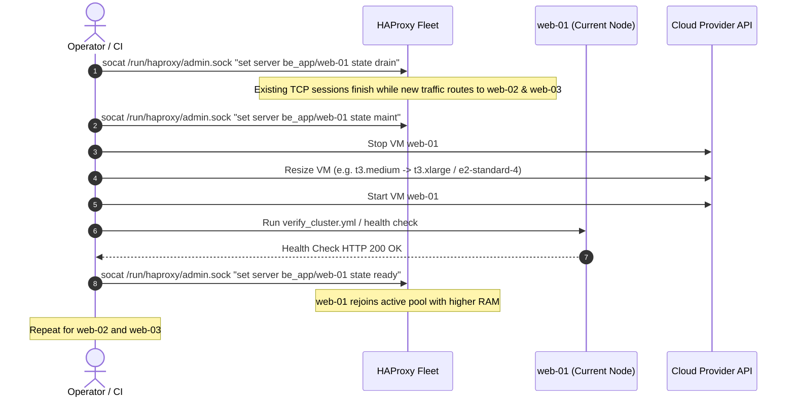

# Resource Sizing, Memory Management & Zero-Downtime Vertical Scaling

## Overview

Operating high-availability infrastructure across edge proxies, clustered webservers, databases, in-memory caches, and message brokers requires proactive memory planning and predictable vertical scaling procedures.

This guide details:
1. **Minimum Memory Sizing Matrix** by role and environment tier.
2. **Automated Pre-Flight Memory Assertions** to catch under-provisioned instances before software installation.
3. **Runtime Service Memory Bounds** preventing out-of-memory (OOM) kernel panics.
4. **Zero-Downtime Vertical Scaling Procedures** for migrating live instances to higher compute tiers across hyperscalers and private clouds.

---

## 1. Sizing Matrix & Minimum Memory Requirements

| Role / Component | Minimum RAM (Staging / Dev) | Recommended RAM (Production) | Critical Runtime Memory Settings |
| :--- | :--- | :--- | :--- |
| **Edge Proxies (`proxies`)** | 1024 MB (1 GB) | 2048 MB – 4096 MB | `haproxy_maxconn: 10000`, Stick-table size: 100k IPs |
| **Backend Webservers (`webservers`)** | 1024 MB (1 GB) | 2048 MB – 8192 MB | Nginx `worker_connections: 1024`, PHP-FPM / Node / Python workers |
| **Database (`databases`)** | 2048 MB (2 GB) | 4096 MB – 32768 MB | PostgreSQL `shared_buffers` (25% of RAM), `work_mem: 16MB`, PgBouncer |
| **In-Memory Cache (`redis_servers`)** | 1024 MB (1 GB) | 2048 MB – 16384 MB | `redis_maxmemory: "512mb"` to `"8gb"`, `maxmemory-policy: allkeys-lru` |
| **Message Broker (`rabbitmq_servers`)** | 2048 MB (2 GB) | 4096 MB – 16384 MB | `rabbitmq_vm_memory_high_watermark: 0.6` (allocates up to 60% of host RAM) |
| **Monitoring Server (`monitoring`)** | 2048 MB (2 GB) | 4096 MB – 8192 MB | Prometheus TSDB block retention, Grafana SQLite/PostgreSQL store |
| **Teleport Gateway (`teleport_servers`)**| 1024 MB (1 GB) | 2048 MB – 4096 MB | Session recording buffer, audit log stream |
| **FreeIPA Server (`freeipa_servers`)** | 2048 MB (2 GB) | 4096 MB – 8192 MB | 389 Directory Server database cache, Dogtag PKI, Kerberos KDC |

---

## 2. Automated Pre-Flight Memory Verification

The `system_base` role includes an automated pre-flight assertion engine ([`roles/system_base/tasks/assert.yml`](../roles/system_base/tasks/assert.yml)) that evaluates `ansible_memtotal_mb` against role requirements before packages are installed.

### Enabling Pre-Flight Assertions

In your `group_vars/all.yml` or command line, enable memory enforcement:

```yaml
# Enable strict RAM validation during cluster provisioning:
enforce_min_memory_check: true

# Baseline minimum for general cluster nodes (in MB)
min_general_memory_mb: 800

# Role-specific minimum RAM definitions (in MB)
min_role_memory_mb:
  proxies: 800           # 1GB class (t3.micro, e2-micro, B1s)
  webservers: 800        # 1GB class
  databases: 1800        # 2GB class (t3.small, e2-small, B2s)
  redis_servers: 800     # 1GB class
  rabbitmq_servers: 1800 # 2GB class (Erlang VM + mnesia)
  monitoring: 1800       # 2GB class (Prometheus TSDB + Grafana)
  teleport_servers: 1800 # 2GB class
  freeipa_servers: 1800  # 2GB class (389 Directory Server + KDC)
```

### Per-Host Custom Overrides

You can specify explicit memory requirements directly on any host in your inventory:

```ini
[databases]
db-primary ansible_host=10.0.1.40 min_memory_mb=7800
```

If a target machine has insufficient memory, Ansible fails early with a clear remediation message:
```text
fatal: [db-primary]: FAILED! => {
    "assertion": "ansible_memtotal_mb >= 7800",
    "msg": "Host 'db-primary' has 3920 MB total RAM, which does not satisfy the required minimum of 7800 MB for roles in groups ['databases', 'headless_nodes']. Please scale up the instance tier or set 'enforce_min_memory_check: false' to override."
}
```

---

## 3. Runtime Memory Controls & OOM Defense

To ensure that sudden traffic spikes or query anomalies do not crash services:

1. **Redis LRU Eviction**:
   Redis strictly limits its working set via `redis_maxmemory` ([`roles/redis/defaults/main.yml`](../roles/redis/defaults/main.yml)). When memory reaches this limit, it automatically evicts the least recently used keys (`allkeys-lru`), returning cached memory without crashing.
2. **RabbitMQ Memory High Watermark**:
   RabbitMQ continuously tracks host RAM via `rabbitmq_vm_memory_high_watermark: 0.6`. If broker memory reaches 60% of physical host RAM, RabbitMQ temporarily halts publisher TCP sockets, applying backpressure until background consumers drain queues.
3. **PostgreSQL Memory Allocation**:
   `postgresql_shared_buffers` is configured to a dedicated percentage (typically 25% of physical RAM), preventing database processes from starving OS page cache.
4. **Linux Kernel Swap Tuning**:
   `roles/system_base` configures a 2GB encrypted swap file with conservative `vm.swappiness = 10` and `vm.vfs_cache_pressure = 50`. This acts as an emergency buffer during temporary spikes rather than triggering the Linux Out-Of-Memory (OOM) killer.

---

## 4. Zero-Downtime Vertical Scaling (Migrating to Higher Tiers)

When a node requires more CPU cores or RAM, you can seamlessly migrate instances to higher instance types/flavors without user interruption.

### A. Clustered Backend Webservers (Scenario 2 & 3)

Because HAProxy actively monitors and balances traffic across webserver pools, web nodes can be scaled one at a time using HAProxy's runtime administrative socket:



#### Step-by-Step Execution:
1. **Drain Connections**:
   ```bash
   echo "set server be_app_example_com/web-01 state drain" | sudo socat stdio /run/haproxy/admin.sock
   sleep 10
   echo "set server be_app_example_com/web-01 state maint" | sudo socat stdio /run/haproxy/admin.sock
   ```
2. **Resize VM via Cloud CLI**:
   * **AWS EC2**:
     ```bash
     aws ec2 stop-instances --instance-ids i-xxxxxxx
     aws ec2 wait instance-stopped --instance-ids i-xxxxxxx
     aws ec2 modify-instance-attribute --instance-id i-xxxxxxx --instance-type "{\"Value\": \"t3.xlarge\"}"
     aws ec2 start-instances --instance-ids i-xxxxxxx
     ```
   * **Google Cloud (GCP)**:
     ```bash
     gcloud compute instances stop web-01 --zone us-central1-a
     gcloud compute instances set-machine-type web-01 --zone us-central1-a --machine-type e2-standard-4
     gcloud compute instances start web-01 --zone us-central1-a
     ```
   * **Microsoft Azure**:
     ```bash
     az vm stop --resource-group cluster-rg --name web-01
     az vm deallocate --resource-group cluster-rg --name web-01
     az vm resize --resource-group cluster-rg --name web-01 --size Standard_B4ms
     az vm start --resource-group cluster-rg --name web-01
     ```
   * **OpenStack**:
     ```bash
     openstack server resize --flavor m1.large web-01
     openstack server resize confirm web-01
     ```
   * **Oracle Cloud (OCI)**:
     ```bash
     oci compute instance update --instance-id ocid1.instance.oc1... --shape VM.Standard.E4.Flex --shape-config '{"ocpus": 4, "memoryInGBs": 16}'
     ```
3. **Verify and Re-introduce Node**:
   ```bash
   ansible-playbook -i inventory.ini verify_cluster.yml --limit web-01
   echo "set server be_app_example_com/web-01 state ready" | sudo socat stdio /run/haproxy/admin.sock
   ```
4. **Advance to the next node** (`web-02`, then `web-03`). The site maintains continuous 100% availability throughout the upgrade.

---

### B. Database Tier (PostgreSQL Primary & Streaming Replica)

In **Scenario 2**, the database tier uses a Single-Primary write master (`db-primary`) and Streaming Read Replica (`db-replica-1`):

1. **Resize the Read Replica First**:
   Stop `db-replica-1`, scale its instance type, restart it, and confirm WAL replication catches up (`select * from pg_stat_replication;`).
2. **Perform Managed Promotion / Failover**:
   Promote `db-replica-1` to write master (or switch traffic via PgBouncer on port `6432`).
3. **Resize the Former Primary**:
   Stop `db-primary`, scale its instance type, restart it, and reconfigure it as the new read replica.

---

### C. Cloud-Native Managed Services

When using hyperscaler managed platforms, vertical migration is performed in-place:
* **AWS RDS for PostgreSQL**: Modify instance class with `ApplyImmediately: true`. In Multi-AZ configurations, AWS automatically scales the standby replica first, executes a transparent failover (typically < 35 seconds), and scales the remaining instance.
* **AWS ElastiCache for Redis**: Supports online vertical scaling without cluster downtime.
* **Google Cloud SQL**: Scale the tier directly; high-availability instances failover automatically to the upgraded replica.
* **Azure Database for PostgreSQL Flexible Server**: Update compute tier with zone-redundant automated switchover.
