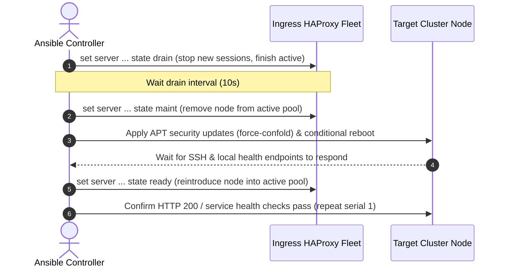

# Zero-Downtime Rolling Maintenance & Kernel Upgrades

## Overview

Applying Linux kernel patches, security updates, and performing reboots on live infrastructure typically risks user-facing HTTP 502/503 errors and connection resets. 

The `rolling_maintenance.yml` playbook automates zero-downtime maintenance by coordinating directly with HAProxy's runtime administrative socket (`/run/haproxy/admin.sock`) and utilizing Keepalived VRRP failover.

---

## Maintenance Workflow



---

## Key Safety Features

1. **Connection Draining via HAProxy Socket**:
   - Executes `set server <backend>/<server> state drain` over `/run/haproxy/admin.sock`.
   - Ongoing HTTP/HTTPS requests finish gracefully; new client requests are dynamically routed to healthy peer instances.
2. **Configuration Preservation (`force-confold`)**:
   - Upstream package updates (`apt-get upgrade`) preserve customized Nginx, HAProxy, and sysctl configurations without interactive prompts.
3. **Automated Kernel Reboot Detection**:
   - Inspects `/var/run/reboot-required`. Reboots the target node only when newly installed kernels or core system libraries require it.
4. **Health Check Validation**:
   - Verifies Nginx returns HTTP 200/301 before signalling HAProxy to set `state ready`.
5. **Proxy Fleet Maintenance**:
   - Proxies are updated one by one. If Keepalived is enabled, stopping Keepalived gracefully steps down VRRP priority, allowing peer proxies to claim the VIP with zero dropped packets before the node reboots.
6. **Database Tier Maintenance**:
   - Database nodes are updated sequentially (`serial: 1`).
   - For PostgreSQL read replica architectures, replicas are updated first followed by the primary write master.
   - The playbook validates engine responsiveness (`pg_isready` on port 5432, `mysqladmin ping`) and PgBouncer connection pooler availability (port 6432) before moving to subsequent nodes.
7. **Redis Cache Tier Maintenance**:
   - Redis nodes are updated sequentially (`serial: 1`).
   - Reboots only if kernel updates require it; verifies `redis-cli ping` returns `PONG` with authentication before moving forward.
8. **RabbitMQ Broker Tier Maintenance**:
   - RabbitMQ nodes are updated sequentially (`serial: 1`).
   - Runs `rabbitmq-diagnostics check_running` to ensure the Erlang VM and all plugins are healthy before proceeding.
9. **FreeIPA Identity Tier Maintenance**:
   - FreeIPA identity servers are updated sequentially (`serial: 1`).
   - Reboots only if kernel updates require it; verifies `ipactl status` reports 389 Directory Server, Kerberos KDC, and CA services are running before proceeding.
10. **Monitoring & Telemetry Tier Maintenance**:
   - Monitoring instances are updated sequentially (`serial: 1`).
   - Verifies Prometheus `/-/healthy` and Grafana `/api/health` HTTP endpoints respond with HTTP 200 before proceeding.
11. **Teleport Access Gateway Tier Maintenance**:
   - Teleport auth/proxy gateways are updated sequentially (`serial: 1`).
   - Reboots only if kernel updates require it; ensures `teleport` is active and verifies responsiveness with `tctl status` before proceeding.

---

## Execution

Run the rolling maintenance playbook:

```bash
# Standard rolling update (reboots only if kernel updates require it):
ansible-playbook -i inventory.ini rolling_maintenance.yml

# Force reboot all cluster nodes after updates regardless of status:
ansible-playbook -i inventory.ini rolling_maintenance.yml -e "force_reboot=true"

# Run against production or staging inventory:
ansible-playbook -i inventories/production/hosts.ini rolling_maintenance.yml
ansible-playbook -i inventories/staging/hosts.ini rolling_maintenance.yml
```
