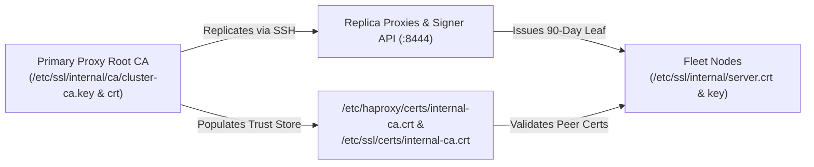

# Secret Rotation & Cryptographic Key Management Guide

## 1. Overview & Operational Principles

Securing an enterprise cluster over its entire lifecycle requires structured, audited, and repeatable procedures for rotating passwords, tokens, API keys, and cryptographic certificates. 

This guide defines the end-to-end operational procedures for rotating all credentials in the cluster with zero service interruption or controlled maintenance windows.

### Secret Inventory & Rotation Cadence Matrix

| Secret / Credential | Storage Location | Recommended Rotation Frequency | Zero-Downtime Capable? | Impacted Services |
| :--- | :--- | :--- | :--- | :--- |
| **Ansible Vault Master Passphrase** | Local `.vault_pass` / CI Secret Store | 90 days or on team departure | **Yes** (orchestrator only) | None (controller encryption only) |
| **Database App Password (PostgreSQL)** | `group_vars/all/vault.yml` | 90 days | **Yes** (via dual-role or staged reload) | PostgreSQL, Nginx / Web Applications |
| **Database App Password (MySQL)** | `group_vars/all/vault.yml` | 90 days | **Yes** (via `RETAIN CURRENT PASSWORD`) | MySQL, Nginx / Web Applications |
| **PostgreSQL Replication Password** | `group_vars/all/vault.yml` | 180 days | **Yes** (staged primary + replica reload)| PostgreSQL primary & read replicas |
| **Redis Auth (`requirepass`)** | `group_vars/all/vault.yml` | 90 days | **Yes** (via runtime `CONFIG SET`) | Redis, Application workers |
| **RabbitMQ User Credentials** | `group_vars/all/vault.yml` | 90 days | **Yes** (via `rabbitmqctl change_password`)| RabbitMQ, Celery/Worker processes |
| **RabbitMQ Erlang Cookie** | `/var/lib/rabbitmq/.erlang.cookie` | On compromise only | **No** (requires rolling restart) | RabbitMQ cluster nodes |
| **Internal Root CA Private Key** | Primary Proxy `/etc/ssl/internal/ca/` | 730 days (auto-renewed at 30) | **Yes** (automated proxy sync) | HAProxy proxies, all TLS clients |
| **Internal Leaf TLS Certificates** | All Fleet Nodes `/etc/ssl/internal/` | 90 days (auto-renewed at 14) | **Yes** (graceful service reload) | HAProxy, Nginx, Telemetry, Data/Broker TLS |
| **Edge ACME TLS Certificates** | Master Proxy `/root/.acme.sh/` | 60 days (automated via ACME) | **Yes** (automated cron sync) | HAProxy frontend ingress |
| **Teleport Node Join Token** | `group_vars/all/vault.yml` | 90 days (or dynamic TTLs) | **Yes** (existing nodes stay joined) | Teleport proxy & enrolled agents |
| **FreeIPA Admin & DM Passwords** | FreeIPA LDAP directory | 90 days | **Yes** (via `ipa passwd` / `ldappasswd`)| FreeIPA KDC, Directory Server |
| **Break-Glass Admin SSH Keys** | `vars/admin_users.yml` | 90 days or staff changes | **Yes** (staged key distribution) | All cluster nodes (port 22) |

---

## 2. Rotating the Ansible Vault Master Passphrase

The Ansible Vault passphrase encrypts `group_vars/all/vault.yml` and other sensitive environment definitions.

### Procedure:
1. **Generate a new secure passphrase**:
   ```bash
   openssl rand -base64 32 > ~/.vault_pass_new
   chmod 600 ~/.vault_pass_new
   ```

2. **Rekey encrypted vault files**:
   ```bash
   ansible-vault rekey group_vars/all/vault.yml \
     --vault-password-file ~/.vault_pass \
     --new-vault-password-file ~/.vault_pass_new
   ```

3. **Verify decryption with the new passphrase**:
   ```bash
   ansible-vault view group_vars/all/vault.yml --vault-password-file ~/.vault_pass_new
   ```

4. **Promote the new passphrase**:
   ```bash
   mv ~/.vault_pass_new ~/.vault_pass
   ```

5. **Update CI/CD Secret Variables**:
   Update `ANSIBLE_VAULT_PASSWORD` or the corresponding secret secret manager key in your CI/CD pipeline (GitHub Actions, GitLab CI, Jenkins).

---

## 3. Zero-Downtime Database Credential Rotation

### A. PostgreSQL Application Password Rotation

PostgreSQL does not natively support two simultaneous passwords for a single role. To rotate application credentials with zero dropped transactions, use the **Staged Alias Role Pattern** or immediate synchronized reload:

#### Option 1: Synchronized Role Update
1. Update the password directly in PostgreSQL on the primary database node:
   ```bash
   su - postgres -c "psql -c \"ALTER ROLE app_user WITH PASSWORD 'NewSecurePassword123!';\""
   ```
2. Update the secret in `group_vars/all/vault.yml`:
   ```bash
   ansible-vault edit group_vars/all/vault.yml
   ```
3. Run the webserver application deployment to update database connection strings and reload application workers:
   ```bash
   ansible-playbook -i inventory.ini playbook.yml --tags webservers
   ```

#### Option 2: Zero-Downtime Dual-Role Migration (Zero Dropped Queries)
1. Create a secondary application user with identical permissions:
   ```sql
   CREATE ROLE app_user_v2 WITH LOGIN PASSWORD 'NewSecurePassword123!';
   GRANT app_user TO app_user_v2;
   ```
2. Update `group_vars/all/vault.yml` with `app_user_v2` and deploy to webservers.
3. Once all webservers are running on `app_user_v2`, drop or retire `app_user`:
   ```sql
   DROP ROLE app_user;
   ```

### B. MySQL Application Password Rotation (MySQL 8.0+ Dual Passwords)

MySQL 8.0+ natively provides the `RETAIN CURRENT PASSWORD` feature, allowing a primary password and a secondary fallback password to coexist simultaneously:

1. **Assign new password while retaining the existing password**:
   ```sql
   ALTER USER 'app_user'@'%' IDENTIFIED BY 'NewSecurePassword123!' RETAIN CURRENT PASSWORD;
   ```
   *At this stage, webservers connecting with either the old or new password will authenticate successfully.*

2. **Update the Ansible Vault and deploy application configurations**:
   ```bash
   ansible-vault edit group_vars/all/vault.yml
   ansible-playbook -i inventory.ini playbook.yml --tags webservers
   ```

3. **Discard the old password once all webservers have migrated**:
   ```sql
   ALTER USER 'app_user'@'%' DISCARD OLD PASSWORD;
   ```

### C. PostgreSQL Replication Password Rotation

1. Update the replication user password on the primary node:
   ```sql
   ALTER ROLE replicator WITH PASSWORD 'NewReplicationPassword123!';
   ```
2. Update the replica connection string in `/etc/postgresql/<version>/main/postgresql.conf` (or `/var/lib/postgresql/data/postgresql.auto.conf`):
   ```ini
   primary_conninfo = 'host=10.0.1.40 port=5432 user=replicator password=NewReplicationPassword123!'
   ```
3. Reload PostgreSQL on the read replica:
   ```bash
   systemctl reload postgresql
   ```
4. Verify replication state:
   ```sql
   SELECT client_addr, state, sync_state FROM pg_stat_replication;
   ```

---

## 4. Live Redis Authentication (`requirepass`) Rotation

Redis supports updating its authentication password in memory without terminating client connections:

1. **Set the new password at runtime via `redis-cli`**:
   ```bash
   redis-cli -p 6379 -a 'OldPassword123!' CONFIG SET requirepass 'NewSecurePassword123!'
   ```
   *Existing active TCP connections continue functioning; all new connections require the new password.*

2. **Update `group_vars/all/vault.yml`**:
   ```yaml
   vault_redis_password: "NewSecurePassword123!"
   ```

3. **Persist the password to `/etc/redis/redis.conf`**:
   Run the Redis role tasks so subsequent service reboots load the new password:
   ```bash
   ansible-playbook -i inventory.ini playbook.yml --tags redis
   ```

4. **Update connected web application services**:
   ```bash
   ansible-playbook -i inventory.ini playbook.yml --tags webservers
   ```

---

## 5. RabbitMQ Credential & Erlang Cluster Cookie Rotation

### A. User Password Rotation (Zero Downtime)
1. Update user password on any cluster node:
   ```bash
   rabbitmqctl change_password app_user "NewRabbitPassword123!"
   ```
2. Update `group_vars/all/vault.yml`.
3. Deploy updated credentials to application workers:
   ```bash
   ansible-playbook -i inventory.ini playbook.yml --tags webservers
   ```

### B. Erlang Cluster Cookie Rotation (Scheduled Maintenance)
The Erlang cookie (`/var/lib/rabbitmq/.erlang.cookie`) allows RabbitMQ nodes in a cluster to communicate. Changing it requires an orchestrated rolling restart:

1. Stop RabbitMQ across the cluster:
   ```bash
   ansible rabbitmq_servers -i inventory.ini -m systemd -a "name=rabbitmq-server state=stopped" --become
   ```
2. Distribute the new 32-character alphanumeric cookie:
   ```bash
   ansible rabbitmq_servers -i inventory.ini -m copy -a "content='NEW_ERLANG_COOKIE_VALUE' dest=/var/lib/rabbitmq/.erlang.cookie owner=rabbitmq group=rabbitmq mode=0400" --become
   ```
3. Start RabbitMQ nodes sequentially:
   ```bash
   ansible-playbook -i inventory.ini rolling_maintenance.yml --tags rabbitmq
   ```
4. Verify cluster status:
   ```bash
   rabbitmqctl cluster_status
   ```

---

## 6. Internal Root CA & Leaf Certificate Lifecycle

### Architecture:
- **Root CA**: Valid for 730 days (2 years), ECDSA P-384 (`secp384r1` with SHA-384). Hosted on the primary ingress proxy at `/etc/ssl/internal/ca/cluster-ca.crt` and `/etc/ssl/internal/ca/cluster-ca.key`, replicated across peer proxies via `/usr/local/bin/sync-haproxy-certs.sh`, and automatically renewed at the 30-day threshold by `/usr/local/bin/renew-internal-ca.sh` (`renew-internal-ca.timer`).
- **Leaf Certificates**: Valid for 90 days. Signed via `internal-ca-signer` (Port 8444) and installed across fleet nodes at `/etc/ssl/internal/server.crt` and `/etc/ssl/internal/server.key`, automatically renewing at 14 days via `/usr/local/bin/renew-internal-cert.sh`.
- **Trust Anchor**: `/etc/haproxy/certs/internal-ca.crt` on HAProxy proxies and `/etc/ssl/certs/internal-ca.crt` (registered in the OS trust store at `/usr/local/share/ca-certificates/cluster-internal-ca.crt`) on all enrolled nodes.



### Staged Leaf Certificate Rotation (Scheduled or Pre-Expiry)

1. Force immediate leaf certificate regeneration across fleet nodes using the autonomous client script:
   ```bash
   ansible all -i inventory.ini -m command -a "/usr/local/bin/renew-internal-cert.sh --force" --become
   ```
2. Verify expiration dates and active TLS daemons:
   ```bash
   ansible webservers -i inventory.ini -m command -a "openssl x509 -enddate -noout -in /etc/ssl/internal/server.crt" --become
   ```
   `/usr/local/bin/renew-internal-cert.sh` automatically reloads active services (Nginx, Rsyslog, Node Exporter) without dropping connections, and HAProxy validates the new leaf certificate on the next health probe.

### Emergency Root CA Key Revocation & Replacement

If the private key of the internal Root CA (`/etc/ssl/internal/ca/cluster-ca.key`) is compromised:

1. **Generate New Root CA** on the primary proxy (`cert_primary_host`) with a fresh ECDSA P-384 keypair at `/etc/ssl/internal/ca/cluster-ca-v2.{key,crt}`.
2. **Create Combined Trust Bundle**:
   Temporarily combine old and new CA certificates while nodes re-enroll:
   ```bash
   cat /etc/ssl/internal/ca/cluster-ca.crt /etc/ssl/internal/ca/cluster-ca-v2.crt > /etc/haproxy/certs/internal-ca.crt
   ```
3. **Sync Bundle & Reload HAProxy Proxies**:
   Synchronize `/etc/haproxy/certs/internal-ca.crt` across proxies and reload HAProxy (`systemctl reload haproxy`) so HAProxy accepts certificates signed by either the old or new CA during cutover.
4. **Promote New CA on Signer Proxies & Re-Issue Leaf Certificates**:
   Replace `cluster-ca.key` and `cluster-ca.crt` with the `v2` files across `/etc/ssl/internal/ca/` on all proxies, run `/usr/local/bin/sync-haproxy-certs.sh`, restart `internal-ca-signer`, and force leaf renewal fleet-wide:
   ```bash
   ansible all -i inventory.ini -m command -a "/usr/local/bin/renew-internal-cert.sh --force" --become
   ```
5. **Prune Old Root CA**:
   Replace `/etc/haproxy/certs/internal-ca.crt` across proxies with only the new `cluster-ca.crt` and reload HAProxy.

---

## 7. Teleport Access & Identity Rotation

### A. Node Join Token Rotation
1. Update `vault_teleport_auth_token` in `group_vars/all/vault.yml`.
2. Apply to `teleport_servers` and `teleport_nodes`:
   ```bash
   ansible-playbook -i inventory.ini playbook.yml --tags teleport
   ```
   *Already joined nodes do not drop connection; future node enrollments utilize the new token.*

### B. Teleport Internal Certificate Authority Rotation
To rotate Teleport's user and host CAs cleanly:
```bash
# Initiate CA rotation in Teleport
tctl auth rotate --phase=init
tctl auth rotate --phase=update
tctl auth rotate --phase=rollback   # if issues arise
tctl auth rotate --phase=finish
```

---

## 8. FreeIPA Admin & Service Keytab Rotation

### A. Directory Manager & Admin Password
1. Change admin password:
   ```bash
   ipa passwd admin
   ```
2. Update directory manager password:
   ```bash
   ldappasswd -H ldap://ipa.internal.lan -x -D "cn=Directory Manager" -W -S "cn=Directory Manager"
   ```

### B. Service Keytab Re-Issuance
If a host keytab (`/etc/krb5.keytab`) is compromised:
```bash
ipa-getkeytab -s ipa.internal.lan -p host/web-01.internal.lan -k /etc/krb5.keytab
chmod 600 /etc/krb5.keytab
systemctl restart sssd
```

---

## 9. Break-Glass Local Administrator Key Rotation

Local administrative accounts defined in `vars/admin_users.yml` provide out-of-band access when network identity providers are offline.

### Procedure:
1. Generate a new Ed25519 keypair on administrator workstation:
   ```bash
   ssh-keygen -t ed25519 -a 100 -f ~/.ssh/id_cluster_admin_2026
   ```

2. Add the new public key to `vars/admin_users.yml` while temporarily keeping the previous public key in `authorized_keys`.

3. Deploy updated keys to all cluster hosts:
   ```bash
   ansible-playbook -i inventory.ini playbook.yml --tags admin_users
   ```

4. Verify SSH access to all nodes using the new private key:
   ```bash
   ssh -i ~/.ssh/id_cluster_admin_2026 ubuntu@10.0.1.10 "whoami"
   ```

5. Remove the obsolete public key from `vars/admin_users.yml` and redeploy.

---

## 10. Post-Rotation Verification & Audit Runbook

Following any credential or key rotation procedure, run the automated verification suite to assert cluster health:

```bash
# 1. Verify cluster connectivity, listening ports, and health checks
ansible-playbook -i inventory.ini verify_cluster.yml

# 2. Run chaos and resilience drills
ansible-playbook -i inventory.ini chaos_drill.yml

# 3. Check Prometheus alert rules
ansible monitoring -i inventory.ini -m command -a "curl -s http://127.0.0.1:9090/api/v1/alerts" --become
```
