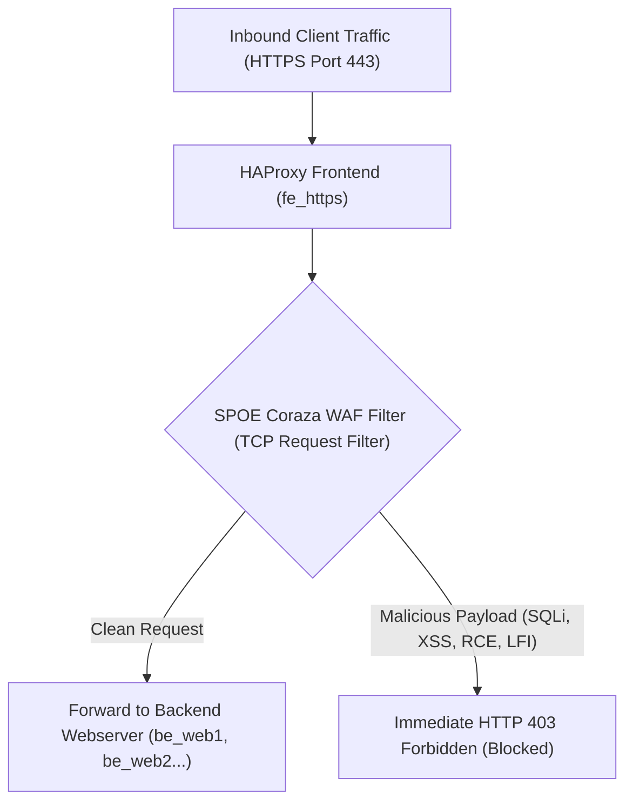

# Coraza Web Application Firewall (WAF) Integration Guide

This suite features native integration with **[Coraza WAF](https://coraza.io/)**, an enterprise-grade, OWASP Core Rule Set (CRS) compatible Web Application Firewall. Coraza runs as an external Stream Processing Offload Agent (SPOA) connected to HAProxy via SPOE (Stream Processing Offload Engine), providing deep HTTP inspection without modifying application code.

---

## 1. Architecture Overview



### Key Technical Characteristics:
- **Zero Inline Overhead**: HAProxy communicates with `coraza-spoa` via non-blocking TCP socket (`127.0.0.1:9000`).
- **OWASP CRS Compliance**: Inspects request headers, paths, query strings, and request bodies for SQL Injection, Cross-Site Scripting (XSS), Path Traversal, and Command Injection.
- **Enabled by Default**: Activated out of the box via `haproxy_enable_coraza_waf: true`.

---

## 2. Configuration & Directives

### Configuration Variables in `roles/proxy/defaults/main.yml`:
```yaml
# Coraza WAF Engine Settings
haproxy_enable_coraza_waf: true      # Toggle Coraza WAF (default: true)
coraza_spoa_port: 9000               # Local TCP port for SPOA daemon
coraza_spoa_bind: "127.0.0.1"        # Bind address
coraza_config_dir: "/etc/coraza"     # Rules and configuration directory
coraza_spoa_version: "v0.4.0"        # Release binary version
```

### HAProxy SPOE Filter (`/etc/haproxy/coraza-spoe.cfg`):
```haproxy
[coraza]
spoe-agent coraza-agent
    messages check-request
    option var-prefix coraza
    timeout hello 150ms
    timeout idle 30s
    timeout processing 500ms
    use-backend be_coraza

spoe-message check-request
    args app=str(headless_app) id=unique-id src=src ip=src port=src_port method=method path=path query=query version=req.ver headers=req.hdrs body=req.body
    event on-frontend-http-request
```

### HAProxy Frontend Interception Rule:
```haproxy
frontend fe_https
    # ...
    filter spoe engine coraza config /etc/haproxy/coraza-spoe.cfg
    http-request deny deny_status 403 if { var(txn.coraza.action) -m str deny }
```

---

## 3. Disabling or Tuning Coraza WAF

If you wish to run without the WAF layer:
```yaml
# In group_vars/proxies.yml or playbook vars:
haproxy_enable_coraza_waf: false
```
Running `ansible-playbook -i inventory.ini playbook.yml --tags proxy` will cleanly remove the SPOE filter from HAProxy and stop the `coraza-spoa` service.
